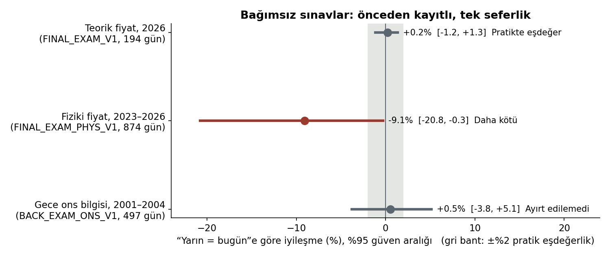
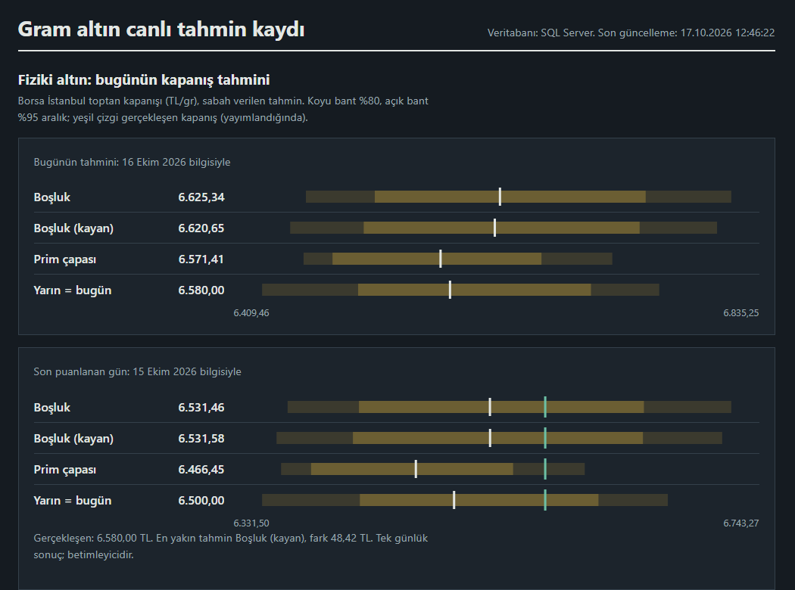
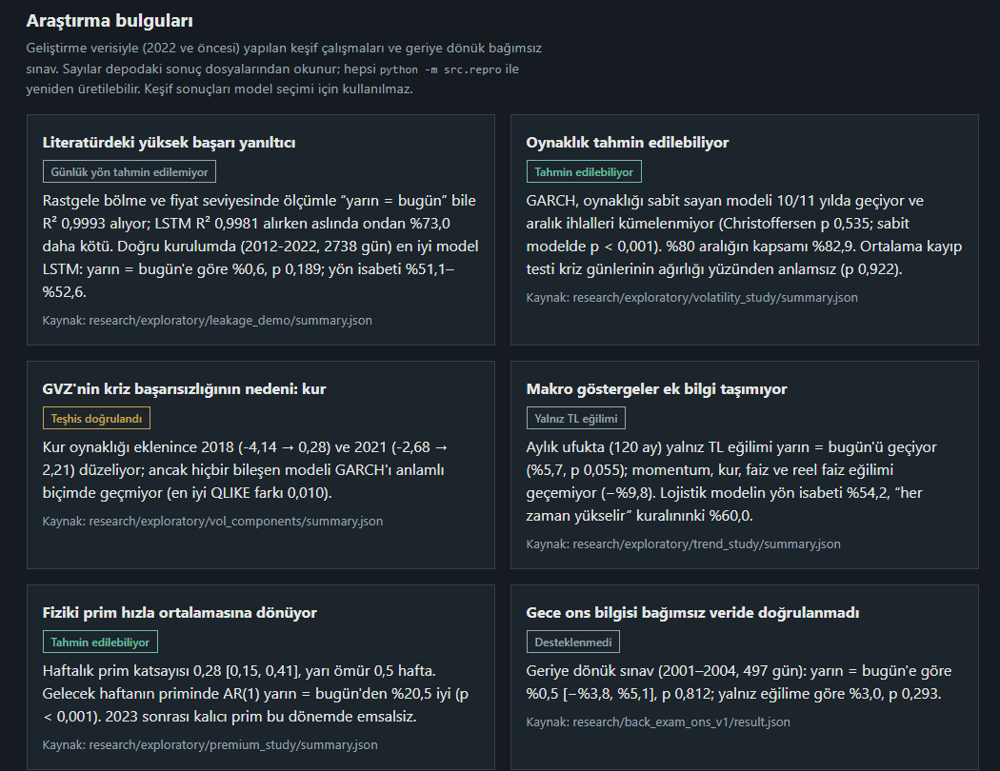

# Turkey Gold Price Forecast

Machine learning-based forecasting and analysis of **physical** and **theoretical** gram gold prices in Turkey, built on ounce gold, USD/TRY, market indicators and official TCMB EVDS data, with a strong emphasis on **leakage-free, pre-registered and independently tested evaluation**.

> **Status:** Graduation project (Selçuk University, Computer Engineering). The research, the live forecasting system (running since 2026-10-15), the SQL Server database, the REST API and the web dashboard are complete. The one-shot evaluation of the live protocols is due after 120 forecasts (~April 2027).
> 📄 **Interim report (Turkish):** [docs/danisman_raporu.md](docs/danisman_raporu.md)

> **Türkçe özet:** Proje, Türkiye'deki fiziki gram altın fiyatı (Borsa İstanbul, TCMB EVDS, 1995–2026) ile ons × USD/TRY'den hesaplanan teorik fiyat için kısa vadeli tahmin ve tahmin aralıkları üretir. Bütün sonuçlar kronolojik, sızıntısız testlerle ve önceden kayıtlı, tek seferlik bağımsız sınavlarla değerlendirilir. Temel bulgular: (1) Günlük fiyatı "yarın = bugün" yönteminden anlamlı biçimde daha iyi tahmin etmek üç bağımsız sınavın hiçbirinde başarılamadı. (2) Literatürdeki yüksek başarı oranları büyük ölçüde değerlendirme hatalarından geliyor: fiyat seviyesinde R² "yarın = bugün" için bile 0,999; doğru kurulumda LSTM dahil hiçbir model bu yöntemi geçemiyor. (3) Tahmin edilebilir olan oynaklık: GARCH, sabit oynaklığı 11 yılın 10'unda geçiyor. (4) Gece ons ve kur hareketi fiziki fiyata yansıyor (2012–2022'de %22 daha az hata), ama 2023 sonrasındaki emsalsiz fiziki prim rejimi bu ilişkiyi bozdu. (5) Sistem 15 Ekim 2026'dan beri canlı tahminleri değiştirilemez biçimde kaydediyor; SQL Server, REST API ve web panosu çalışıyor.

---

## Table of Contents

- [Overview](#overview)
- [Key Findings](#key-findings)
- [Live System](#live-system)
- [Web Dashboard](#web-dashboard)
- [System Architecture](#system-architecture)
- [Methodology](#methodology)
- [Tech Stack](#tech-stack)
- [Project Structure](#project-structure)
- [Getting Started](#getting-started)
- [Usage](#usage)
- [Literature Review](#literature-review)
- [Roadmap](#roadmap)
- [Limitations](#limitations)
- [License](#license)

---

## Overview

Gram gold is one of the most widely held savings instruments in Turkey. Its price is driven mainly by the global ounce gold price and the USD/TRY exchange rate, but the domestic physical market can trade at a premium or discount. This project keeps two price series **separate**:

| | Theoretical gram price | Physical gram price |
|---|---|---|
| Definition | ounce (USD) × USD/TRY / 31.1035 | Daily close of the Borsa Istanbul precious metals market (TL/kg / 1000) |
| Source | Yahoo Finance | TCMB EVDS (Istanbul Gold Exchange archive 1995–2018, Borsa Istanbul 2018–) |
| Coverage | 2005 – today | 1995-07 – today |

The physical price is a **wholesale** market price, not a jeweller's buy/sell price.

Many published studies report very high accuracy for gold price forecasting. Most of them use random train/test splits, scaling on the full dataset, or R² on price levels, all of which leak future information. This project asks whether such results hold when only information available at forecast time is used.

## Key Findings

Every result is labelled as **exploratory** (development data; model selection happens here), **independent** (pre-registered, one-shot, unseen data) or **live** (prospective record).



### Independent exams

| Exam | Data | Result |
|---|---|---|
| `FINAL_EXAM_V1` | Theoretical price, 2026, 194 days | **Practically equivalent** to "tomorrow = today" (RW): +0.2% [−1.2%, +1.3%]. Intervals: Kupiec passed, 80% violations clustered |
| `FINAL_EXAM_PHYS_V1` | Physical price, 2023–2026, 874 days | Gap model **9.1% worse than RW** [−20.8%, −0.3%], p = 0.03 |
| `BACK_EXAM_ONS_V1` | Physical price, 2001–2004, 497 days (never-used data) | Overnight-gold model **not distinguishable** from RW (+0.5%, Holm p = 0.81) or from a drift-only model (+3.0%, p = 0.29) |

### Exploratory studies (development data ≤ 2022, all reproducible with `python -m src.repro`)

| Study | Finding |
|---|---|
| **Leakage demonstration** | With random splits and price-level R², even "tomorrow = today" scores R² 0.9993 and LSTM 0.9981, yet LSTM is **73% worse** than RW. Under proper walk-forward evaluation no model (linear, XGBoost, LSTM) beats RW significantly; direction hit rates 51–53%. The LSTM is written from scratch in numpy and verified by numerical gradient checks |
| **Volatility** | Volatility **is** predictable: GARCH beats constant volatility in 10 of 11 years and removes violation clustering (Christoffersen p = 0.54) |
| **TL volatility components** | GVZ (USD gold volatility) fails in the 2018 and 2021 TL crises; adding an FX component fixes this, but no component model beats GARCH |
| **Weekly / monthly trend + macro** | Momentum, FX, gold, US yields and the TL real interest rate (with publication lags) add no information. Only TL drift beats RW (monthly +5.7%, p = 0.055), and it is regime-dependent |
| **Physical premium** | 2006–2022 premium stays near zero with a half-life of ~0.5 weeks; the persistent post-2023 premium is unprecedented, explaining the physical exam failure |
| **Source of the physical gain (2012–2022)** | Overnight gold alone +5.1% (timestamp-independent); with overnight FX +21.7% |
| **Power analysis** | With 120 live forecasts the physical comparison detects a ≥20% improvement with 80% power (development effect: 23%); interval tests have limited power |

### Data findings

- **Timestamp mismatch in Yahoo daily data:** gold close ~18:00 UTC, USD/TRY close ~02:00–05:00 UTC. A synchronized hourly pipeline was built.
- **Look-ahead in 2005–2010 FX data:** Yahoo's daily USD/TRY bar belonged to a time after the Borsa Istanbul close; those years were excluded.
- **Futures roll artifacts:** GC=F rolls create ~1.5–1.9% artificial jumps; a pre-registered scan selected GLD as a spot-tracking source.
- **EVDS 1,000-row limit:** responses are silently truncated; downloads are split automatically.

## Live System

| Protocol | What it records | Since |
|---|---|---|
| `LIVE_PHYS_V1` | Morning forecast of the physical close: RW, Gap, Gap-Rolling, Premium-Anchor | 2026-10-15 |
| `LIVE_PHYS_INT_V1` | Volatility-aware 80% / 95% intervals around each model | 2026-10-15 |
| `LIVE_V1` | Evening forecast of the synchronized theoretical price (GC=F) | 2026-10-15 |
| `LIVE_V2` | Same model with GLD as the gold source (no futures rolls) | 2026-10-15 |

- **Pre-registration:** rules, models and code hashes were committed before the first outcome; locked code cannot change without invalidating forecasts.
- **Integrity:** records are append-only with per-row hashes, scored automatically and committed to git daily.
- **Automation:** Windows Task Scheduler, weekdays 12:30 (retry 13:30) and 22:30.
- **Evaluation:** one-shot, pre-registered, after 120 scored forecasts (~April 2027).

## Web Dashboard

A local, read-only dashboard served by the FastAPI application (`scripts\pano.ps1`, http://127.0.0.1:8000) and backed by the SQL Server mirror. It shows the system status, today's forecasts with 80% / 95% interval bands, the last scored day against the realized price, a price chart, the interim scorecard, the live performance curve, the independent exams and the research findings.





## System Architecture

```
Yahoo Finance, TCMB EVDS ─► data pipeline ─► models ─► live records (git, hashed, append-only)
                                                              │
                                                              ▼
                                         Microsoft SQL Server (read-only mirror)
                                                              │
                                                              ▼
                                           FastAPI (read-only REST API) ─► web dashboard
```

- **Database:** SQL Server (LocalDB) or SQLite; every load verifies all record hashes and writes nothing if any record is tampered with.
- **REST API:** read-only endpoints for forecasts, scorecards, prices, performance curves, exams, research findings and system health (`/docs`).
- **Dashboard:** today's forecasts with interval bands, last scored day, price chart, scorecard, live performance curve, independent exams, research findings and system status.
- **Security:** localhost-only, strict Content-Security-Policy, trusted-host check, protected `main` branch, SHA-pinned GitHub Actions, weekly `pip-audit`.
- **Monitoring:** after every run a health record and a heartbeat are written; a GitHub watchdog checks the heartbeat twice a day and e-mails the owner if a run is missing or failed.
- **Integrity audit:** 31 checks on every push and daily (locked code, pre-registrations, record history, repository hygiene).
- **Reproducibility:** `python -m src.repro` recomputes every exploratory study and the backward exam and compares them number by number with the committed results.

## Methodology

- **Chronological walk-forward evaluation:** expanding window, retraining every 63 trading days, 1-row purge; no random splits.
- **Leakage controls:** explicit timestamps for every input; tests that corrupt all information unknown at forecast time.
- **Pre-registration:** hypotheses, decision rules, code and data hashes are written before each confirmatory run; confirmatory runs execute once and are logged in `research/registry.jsonl`.
- **Statistics:** Diebold–Mariano (HLN correction), Holm correction, paired moving-block bootstrap; Kupiec and Christoffersen tests, Winkler score; QLIKE for volatility.
- **Software quality:** 620+ unit tests on synthetic data, all passing on every push; mutation checks verify that the tests catch deliberate errors.

## Tech Stack

| Area | Technologies |
|------|--------------|
| Language | Python 3.11 |
| Data | pandas, NumPy, yfinance, TCMB EVDS API |
| Modelling | scikit-learn, XGBoost, arch (GARCH), SciPy, numpy LSTM |
| Storage & API | Microsoft SQL Server (LocalDB), SQLAlchemy, pyodbc, FastAPI, uvicorn |
| Frontend | HTML, CSS, vanilla JavaScript (no external libraries) |
| Automation & CI | PowerShell, Windows Task Scheduler, git, GitHub Actions |
| Testing | unittest |

## Project Structure

```
turkey-gold-price-forecast/
├── .github/workflows/     # tests, integrity audit, security scan, watchdog
├── data/                  # raw snapshots and processed data (not tracked by git; backed up daily)
├── docs/                  # interim report, figures, status and data platform notes
├── research/              # pre-registrations, registry, exam results, exploratory results, live logs
├── scripts/               # scheduled tasks, backup, git sync, dashboard launcher
├── src/
│   ├── data/              # Yahoo and EVDS collection, validation, panels, synchronized series, macro data
│   ├── analysis/          # diagnostics and exploratory studies
│   ├── models/            # point and interval models, LSTM, independent exams
│   ├── live/              # live forecasting, intervals, scoring, evaluation rules
│   ├── db/                # SQL Server / SQLite mirror
│   ├── api/               # FastAPI application
│   ├── web/               # dashboard (HTML, CSS, JS)
│   ├── audit.py           # integrity audit
│   ├── health.py          # system health and heartbeat
│   ├── watchdog.py        # GitHub watchdog
│   ├── findings.py        # research findings for the dashboard
│   ├── repro.py           # reproducibility check
│   └── report_figures.py  # report figures from committed results
├── tests/                 # unit tests (synthetic data)
├── Literatur_Taramasi_Raporu_Gram_Altin.pdf
├── LICENSE
├── requirements.txt
└── README.md
```

## Getting Started

```bash
git clone https://github.com/03betulpehlivan/turkey-gold-price-forecast.git
cd turkey-gold-price-forecast
python -m venv .venv
.venv\Scripts\activate            # macOS/Linux: source .venv/bin/activate
pip install -r requirements.txt
python -m unittest discover -s tests
```

Data files are not included in the repository. Market data is downloaded from Yahoo Finance. Physical gold and macro data require a free TCMB EVDS API key, kept **only** in an environment variable and never committed:

```powershell
setx EVDS_API_KEY "your-key"      # Windows, applies to new terminals
```

## Usage

```powershell
# Dashboard and API (http://127.0.0.1:8000, API docs at /docs)
powershell -ExecutionPolicy Bypass -File scripts\pano.ps1

# Checks
python -m src.audit                       # integrity audit
python -m src.repro                       # recompute and compare all exploratory results
python -m src.health show                 # system health
python -m src.report_figures              # redraw report figures

# Exploratory studies (development data only)
python -m src.analysis.leakage_demo
python -m src.analysis.volatility_study
python -m src.analysis.vol_components
python -m src.analysis.trend_study
python -m src.analysis.premium_study
python -m src.analysis.power_study

# Live (normally run by the scheduled tasks)
python -m src.live.physical_forecast card
python -m src.live.forecast_v2 card
```

## Literature Review

A comparative literature review of 23 studies on machine learning-based gold price forecasting, focusing on Turkish gram gold, next-day prediction, model comparison and time-series validation.

📄 **[Read the Literature Review Report](Literatur_Taramasi_Raporu_Gram_Altin.pdf)**

## Roadmap

- [x] Data collection pipeline with immutable snapshots and validation
- [x] Baseline and machine learning models (LR, RF, XGBoost) and an LSTM benchmark
- [x] Leakage-free evaluation, statistical tests, pre-registered confirmations
- [x] Probabilistic forecasts (GARCH, GVZ, adaptive conformal calibration) and volatility studies
- [x] Independent exams (`FINAL_EXAM_V1`, `FINAL_EXAM_PHYS_V1`, backward `BACK_EXAM_ONS_V1`)
- [x] Data timing diagnosis, synchronized hourly pipeline and spot-source selection (GLD)
- [x] Macroeconomic indicators; weekly and monthly trend analysis
- [x] Live forecasting with pre-registered protocols (`LIVE_PHYS_V1`, `LIVE_PHYS_INT_V1`, `LIVE_V1`, `LIVE_V2`) and automation
- [x] Microsoft SQL Server storage, REST API and web dashboard
- [x] Integrity audit, watchdog, reproducibility check, power analysis
- [ ] One-shot evaluation of the live protocols (after 120 forecasts, ~April 2027)
- [ ] Final report

## Limitations

- The physical price is a **wholesale** market price; jeweller prices and workmanship are not covered.
- Post-2022 physical data was consumed by the independent exam; models proposed after it can only be evaluated prospectively.
- Yahoo hourly history covers only about the last two years; the live system archives it daily.
- The 2001–2004 exchange archive is sparse (~170 days/year), limiting the backward exam's power.
- With 120 forecasts, interval calibration tests detect only large deviations.
- **This project is for research and education only and is not financial advice.**

## License

This project is licensed under the MIT License. See the `LICENSE` file for details.
