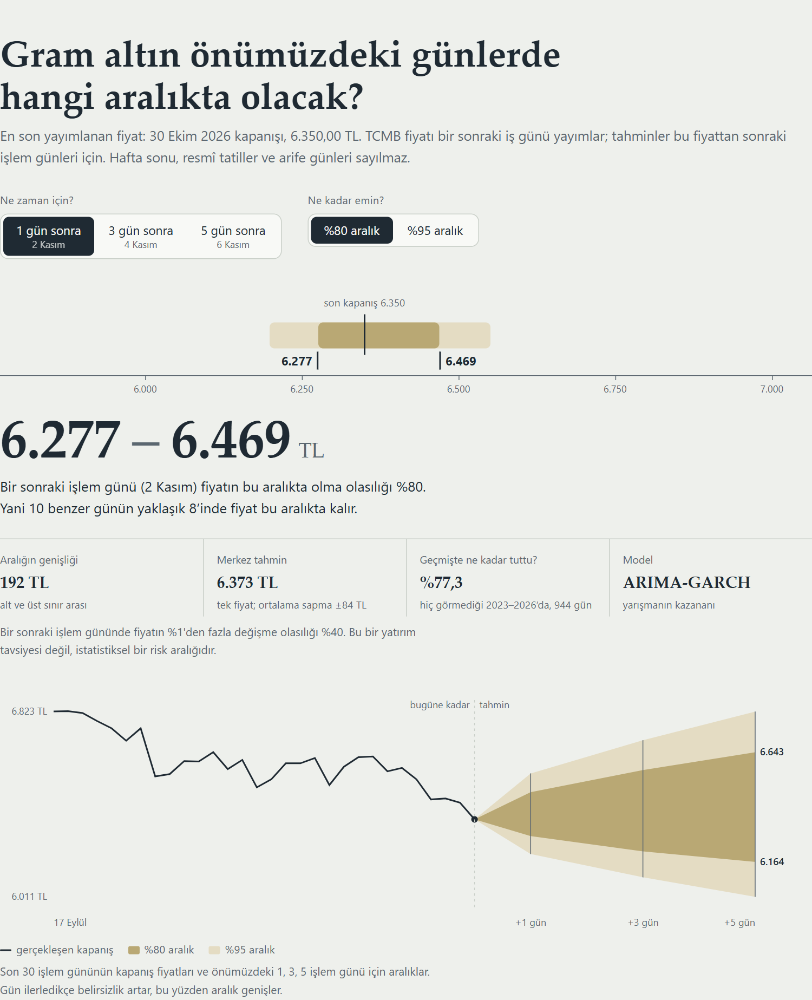
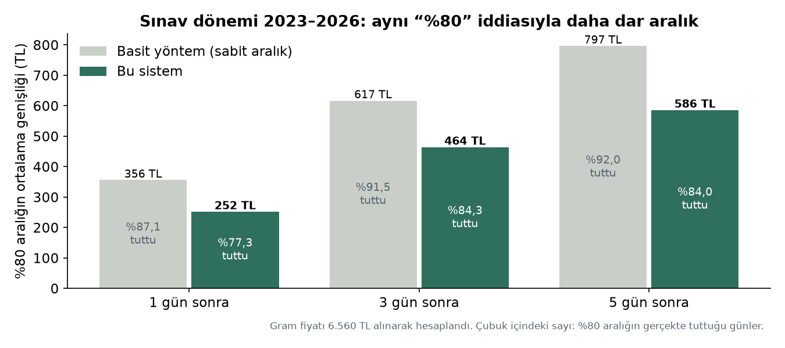
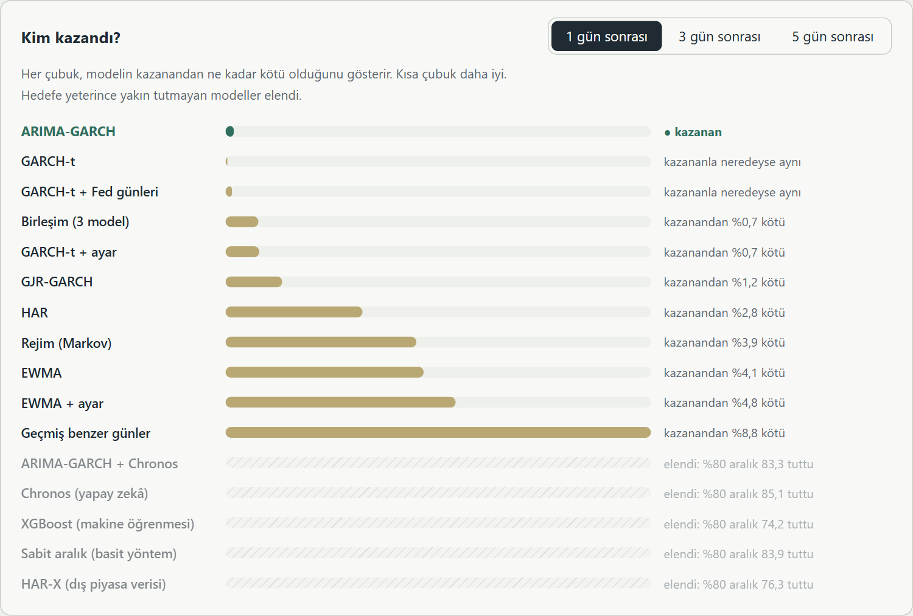
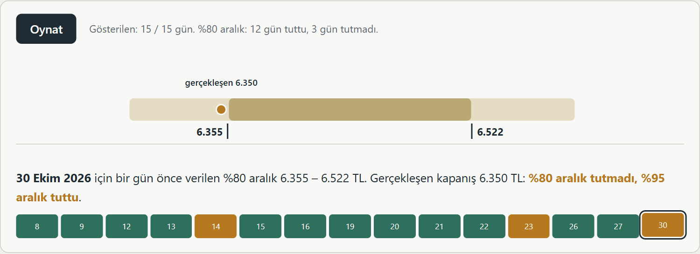

# Gram Altın Fiyat Aralığı Tahmini

Gram altının **1, 3 ve 5 işlem günü sonra hangi fiyat aralığında olacağını** tahmin eden ve bu tahminlerin ne kadar tuttuğunu açıkça gösteren bir sistem.

> *English summary: A forecasting system for the Turkish gram gold price. It predicts 80% and 95% price ranges for 1, 3 and 5 trading days ahead. On unseen 2023–2026 data, its 95% ranges contained the actual price on 94.7–96.2% of days, while its 80% ranges were 25–29% narrower than a naive baseline.*

**Selçuk Üniversitesi Bilgisayar Mühendisliği bitirme projesi** · Fatma Betül Pehlivan
📄 Ayrıntılı rapor: [docs/danisman_raporu.md](docs/danisman_raporu.md)

---

## Ne yapıyor?

Gerçek bir örnek:

> 20 Ekim 2026 kapanışı 6.560 TL.
> Sistem, bir sonraki işlem günü için şunu söyledi: **%80 olasılıkla 6.490 – 6.675 TL**, **%95 olasılıkla 6.414 – 6.753 TL** arasında.
> 21 Ekim kapanışı **6.575 TL** oldu; iki aralığın da içinde kaldı.

Sistem fiyatın yönünü tahmin etmez; çünkü testlerde hiçbir model "yarın altın yükselecek mi?" sorusunda yazı-turadan iyi olmadı. Bunun yerine fiyatın **ne kadar oynayacağını** tahmin eder ve bunu bir aralığa çevirir. Tıpkı hava durumunun "yarın kesin yağmur" demek yerine "%80 olasılıkla yağmur" demesi gibi.



## Temel kavramlar

- **%80 aralık:** 10 benzer günün yaklaşık 8'inde fiyatın içinde kalması beklenen aralık. Kalan 2 günde dışarı çıkması hata değildir.
- **%95 aralık:** 100 günün yaklaşık 95'inde tutması beklenen, daha geniş aralık.
- **İyi bir aralık** söylediği kadar tutar ve olabildiğince dardır. Çok geniş bir aralık her zaman tutar ama bilgi vermez.
- **Hazırlık dönemi (2012–2022):** bütün modeller denendi, en iyisi seçildi.
- **Sınav dönemi (2023–2026):** seçilen model bu yılları hiç görmeden sınandı.
- **İşlem günü:** kapanış fiyatı oluşan gün. Hafta sonu, resmî tatiller ve arife günleri sayılmaz.

## Sonuçlar

16 model hazırlık döneminde yarıştı. Her ufuk için en iyi model seçildi ve sınav döneminde sınandı:

| Tahmin | Kazanan model | "%95" dediği aralık tuttu | "%80" dediği aralık tuttu |
| --- | --- | --- | --- |
| 1 gün sonra | ARIMA-GARCH | **%94,7** | %77,3 |
| 3 gün sonra | ARIMA-GARCH + Chronos | **%96,2** | %84,3 |
| 5 gün sonra | ARIMA-GARCH + Chronos | **%96,2** | %84,0 |

"%80" aralık 1 günde hedefin biraz altında (biraz dar), 3 ve 5 günde biraz üstünde (biraz geniş, yani temkinli).

Bu sistemin %80 aralıkları, aynı "%80" iddiasıyla, basit bir yöntemin aralıklarından **%25 – %29 daha dar**. Basit yöntem "%80" dediği hâlde %87 – %92 tuttu; yani gereğinden genişti. Fark tesadüf değil (üç ufukta da p < 0,01).



**Kriz yıllarında:** sistem, fiyat sert hareket etmeye başlayınca aralığı kendiliğinden genişletiyor, ortalık sakinleşince daraltıyor. 2021 kur krizinde bile "%80" dediği aralık %80,9 tuttu. Ani şoklarda (2020 pandemi, 2023) zorlandı ama çökmedi; "%95" dediği aralık o yıllarda da %91 – %92 tuttu.



**İşe yaramayanlar** (onları da raporluyorum): fiyatın yönünü tahmin etmek, XGBoost ile aralık tahmini, petrol ve dolar gibi dış piyasa verileri, Fed karar günleri ve finans için hazırlanmış Kronos modeli. Ayrıntılar raporda.

## Nasıl test edildi?

- **Model yalnızca geçmişi görür.** Her ayın başında, o güne kadarki son 3 yılın verisiyle yeniden kurulur ve o ayın günlerini tahmin eder.
- **Hazırlık ve sınav ayrı.** Model 2012–2022'de seçildi; 2023–2026 yalnızca sınav. Sınav dönemi, sonuçlara bakılmadan en son dönem olduğu için belirlendi.
- **Veri uydurulmaz.** Tatil ve arife günleri için fiyat uydurulmaz; olağanüstü günler silinmez.
- **İleriye dönük karne.** 21 Ekim 2026'dan beri sistem her sabah tahminini, gerçek fiyat belli olmadan önce değiştirilemez biçimde kaydediyor; fiyat gelince kendiliğinden puanlanıyor.

## Web arayüzü

Arayüz, teknik bilgisi olmayan birinin de anlayabileceği biçimde hazırlandı:

- **Tahmin:** 1, 3, 5 gün ve %80 / %95 seçimi; animasyonlu fiyat cetveli ve sade bir açıklama cümlesi.
- **Aralık ne demek?** Hava durumu benzetmesi, nokta animasyonları, "Aralık çok geniş değil mi?" sorusunun cevabı.
- **Tuttu mu?** Sınav sonuçları, son 15 günü oynatan animasyon, merkez tahminin kaç TL saptığı, bu yıl ve ileriye dönük karne.
- **Kriz yılları**, **nasıl çalışıyor** (adım adım animasyon), **model yarışması** ("Kim kazandı?" animasyonu ve tam tablo), **veri ve incelemeler**, **denenenler** ve **sözlük**.



## Kurulum

Python 3.11 ve Git gerekir.

```powershell
git clone https://github.com/03betulpehlivan/turkey-gold-price-forecast.git
cd turkey-gold-price-forecast
py -3.11 -m venv .venv
.\.venv\Scripts\Activate.ps1
pip install -r requirements.txt
```

Chronos modeli isteğe bağlıdır (birkaç yüz MB indirir): `pip install chronos-forecasting`. Kurulu değilse sistem kendiliğinden ARIMA-GARCH'ı kullanır.

Fiziki altın verisi için ücretsiz bir TCMB EVDS anahtarı gerekir. Anahtar yalnızca ortam değişkeninde tutulur, dosyalara yazılmaz:

```powershell
setx EVDS_API_KEY "anahtarınız"
```

## Kullanım

```powershell
powershell -NoProfile -ExecutionPolicy Bypass -File scripts\pano.ps1   # web arayüzü: http://127.0.0.1:8000
python -m src.live.physical_forecast refresh                           # en güncel fiyatı elle indir
python -m src.tool.yarisma --chronos                                   # model yarışması (10-15 dakika)
python -m src.tool.canli_karne karne                                   # ileriye dönük karne
python -m src.report_figures                                           # rapor grafiklerini yeniden çiz
python -m src.ekran_goruntuleri                                        # arayüz görüntülerini yeniden al (pano açıkken; pip install playwright)
python -m unittest discover -s tests                                   # bütün testler (700'den fazla)
```

## Proje yapısı

```
src/tool/      tahmin araçları: model yarışması, ileriye dönük karne, pano servisi
src/web/       web arayüzü (ana ekran ve ayrıntılı araştırma panosu)
src/api/       REST API (FastAPI)
src/db/        Microsoft SQL Server / SQLite veritabanı katmanı
src/data/      veri indirme (TCMB EVDS, Yahoo Finance, Fed takvimi)
src/models/    ilk aşamanın modelleri ve sınavları
src/analysis/  ilk aşamanın araştırma çalışmaları
research/      sonuç dosyaları, tahmin kayıtları
scripts/       her gün kendiliğinden çalışan görevler
tests/         otomatik testler
docs/          rapor ve grafikler
```

## Teknik özet

- **Veri:** TCMB EVDS (fiziki gram altın, 1995'ten beri; çalışmada 2009 sonrası), Yahoo Finance (ons, kur, piyasa göstergeleri), Fed karar takvimi.
- **Modeller:** GARCH ailesi, ARIMA-GARCH, HAR, Markov rejim modeli, XGBoost, Amazon Chronos, Kronos ve birleşimleri.
- **Altyapı:** Python, Microsoft SQL Server, FastAPI, Windows Görev Zamanlayıcı, GitHub Actions.
- **Güvenilirlik:** her kod değişikliğinde otomatik testler; kayıtların değiştirilmediğini her gün kontrol eden bütünlük denetimi; görev çalışmazsa e-posta gönderen bekçi.

## Lisans

MIT. Ayrıntılar `LICENSE` dosyasında.

**Bu proje araştırma ve eğitim amaçlıdır. Gösterilen aralıklar yatırım tavsiyesi değil, istatistiksel risk aralığıdır.**
