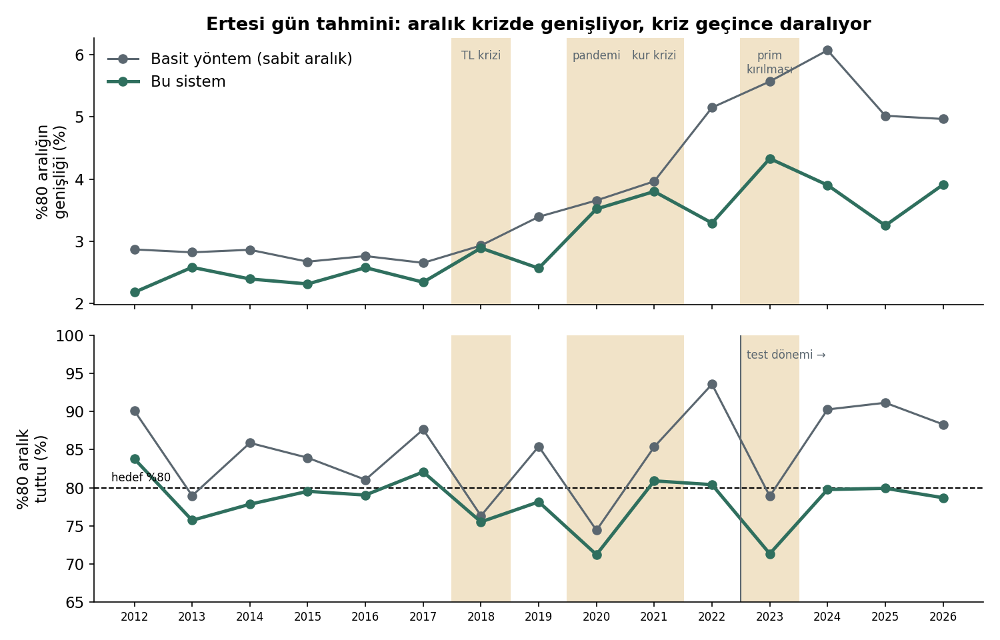

# Gram Altın Fiyat Aralığı Tahmini

**Ara rapor — 22 Ekim 2026**

Fatma Betül Pehlivan · Selçuk Üniversitesi Bilgisayar Mühendisliği · github.com/03betulpehlivan/turkey-gold-price-forecast

---

## 1. Kısaca

Bu proje, gram altının **1, 3 ve 5 gün sonra hangi fiyat aralığında olacağını** tahmin ediyor.

Örnek bir çıktı:

> 20 Ekim 2026 kapanışı 6.560 TL.
> Bir sonraki işlem günü, **%80 olasılıkla 6.490 – 6.675 TL**, **%95 olasılıkla 6.414 – 6.753 TL** arasında olacak.

Üç ana sonuç:

1. **Tahminler tutuyor.** Sistem, hiç görmediği 2023–2026 döneminde (yaklaşık 940 işlem günü) "%95 olasılıkla" dediği aralıkların **%95–96'sında** haklı çıktı.
2. **Basit yöntemden daha faydalı.** Aynı güvenle, basit yöntemin verdiği aralıktan **%25–30 daha dar** aralıklar veriyor. Fark istatistiksel olarak anlamlı (p < 0,01).
3. **Fiyatın yönü tahmin edilemiyor.** "Yarın altın yükselecek mi?" sorusunda hiçbir model yazı-turadan iyi olmadı. Bu yüzden sistem yön değil, **aralık** tahmin ediyor.

## 2. Neden aralık tahmini?

Projenin ilk aşamasında yarınki fiyatı ve yönünü tahmin etmeye çalıştım. Doğrusal model, XGBoost ve LSTM gibi yöntemleri dikkatli testlerle sınadım. Hiçbiri "yarın = bugün" diyen en basit tahminden daha iyi olmadı. Yön tahmininde isabet %51–53 kaldı; yazı-turada bu oran %50.

Bunun nedeni şu: altın dünyanın en çok işlem gören varlıklarından biri. Fiyatın yarın yükseleceği bugünden bilinseydi, herkes bugün alırdı ve fiyat hemen bugün yükselirdi. Bu yüzden günlük yön büyük ölçüde rastgeledir.

Ama fiyatın **ne kadar oynayacağı** tahmin edilebiliyor. Hava durumuna benziyor: yarın yağmurun tam olarak nereye düşeceği bilinmez, ama havanın fırtınalı mı sakin mi olacağı tahmin edilebilir. Altında da çalkantılı günler art arda gelir. Sistem bunu kullanarak "fiyat şu iki değer arasında olacak" diye bir aralık veriyor.

## 3. Nasıl test ettim?

Bir tahmin sisteminin gerçekten işe yarayıp yaramadığını anlamak için, onu **geleceği bilmediği** bir durumda sınamak gerekir. Bunun için iki kural koydum.

**Kural 1: Model her zaman yalnızca geçmişi görür.** Her ayın başında model, o güne kadarki son 3 yılın verisiyle yeniden kuruluyor. Sonra o ayın her günü için 1, 3 ve 5 gün sonrasını tahmin ediyor. Hiçbir tahmin, o günden sonraki fiyatları görmüyor.

**Kural 2: En iyi model, son sınavdan önce seçilir.** Veriyi ikiye ayırdım:

| Dönem | Ne için kullanıldı? |
| --- | --- |
| 2012–2022 | Modeller yarıştı, en iyisi burada seçildi. |
| 2023–2026 | Seçilen model ilk kez burada sınandı (son sınav). |

**"En iyi model" ne demek?** İki şeye birden bakıldı:

- **Tutma oranı:** "%95 olasılıkla" dediği aralık, gerçekten günlerin yaklaşık %95'inde tuttu mu?
- **Darlık:** Aralık ne kadar dar? Çok geniş bir aralık her zaman tutar ama işe yaramaz. "Yarın 1.000 ile 20.000 TL arası" doğrudur ama bilgi vermez.

Tutma oranı hedefe yakın olan modeller arasında **en dar aralığı veren** model kazandı.

## 4. Model yarışması

16 model yarıştı. Bir kısmı basit, bir kısmı istatistik, bir kısmı yapay zekâ modeli:

| Grup | Modeller |
| --- | --- |
| Basit yöntemler | Sabit aralık, geçmiş benzer günler, EWMA |
| Oynaklık modelleri | GARCH-t, GJR-GARCH, ARIMA-GARCH, HAR, rejim modeli (Markov) |
| Ayarlı sürümler | GARCH-t + ayar, EWMA + ayar (aralık ıskaladıkça kendini genişletir) |
| Makine öğrenmesi ve yapay zekâ | XGBoost, Chronos (Amazon'un hazır modeli) |
| Ek bilgili modeller | HAR-X (petrol, dolar, korku endeksi), GARCH-t + Fed günleri |
| Birleşimler | Üç modelin ortalaması; ARIMA-GARCH ile Chronos'un ortalaması |

**Kazananlar:**

| Tahmin | Kazanan model |
| --- | --- |
| 1 gün sonra | ARIMA-GARCH |
| 3 gün sonra | ARIMA-GARCH + Chronos (istatistik ve yapay zekâ birlikte) |
| 5 gün sonra | ARIMA-GARCH + Chronos |

## 5. Sonuç: hiç görülmemiş dönemde ne oldu?

Kazanan modeller 2023–2026'da şu sonuçları verdi:

| Tahmin | "%95 olasılıkla" dediği aralık tuttu | "%80 olasılıkla" dediği aralık tuttu | Basit yönteme göre |
| --- | --- | --- | --- |
| 1 gün sonra | **%94,7** | %77,3 | %13 daha iyi (p = 0,0005) |
| 3 gün sonra | **%96,2** | %84,3 | %13 daha iyi (p < 0,0001) |
| 5 gün sonra | **%96,2** | %84,0 | %10 daha iyi (p = 0,002) |

"Daha iyi" oranı, aralığın hem darlığını hem de tutma oranını birlikte ölçen bir puana göre hesaplandı. Küçük p değerleri, farkın şans eseri olmadığını gösteriyor.

Kullanıcı için anlamı şu grafikte:


Örneğin 1 gün sonrası için basit yöntem ortalama **356 TL** genişliğinde bir aralık veriyor. Bu sistem ise **252 TL** genişliğinde bir aralık veriyor ve yine %95 güvenilir. Yani kullanıcı, aynı güvenle daha net bir bilgi alıyor.

**Zayıf yanlar:**

- Ertesi gün için "%80" dediği aralık %77 tuttu; hedefin biraz altında. En zayıf yıl 2023 (%71). O yıl fiziki altın, uluslararası fiyattan beklenmedik biçimde ayrıştı.
- 3 ve 5 günde "%80" dediği aralık %84 tuttu; yani aralık gerekenden biraz geniş. Bu, ters yönde hata yapmaktan, yani aralığın tutmamasından iyidir.

## 6. Kriz yıllarında ne oldu?

Altın fiyatı her yıl aynı şekilde davranmıyor. Bazı yıllar sakin geçiyor, bazı yıllarda fiyat sert hareket ediyor. Bir tahmin sisteminin asıl sınavı, çalkantılı dönemlerde de çalışıp çalışmadığıdır.

**Model krize nasıl uyum sağlıyor?**

Sistem, son günlerde fiyatın ne kadar oynadığına bakıyor. Fiyat sert hareket etmeye başlarsa, ertesi gün için verdiği aralığı kendiliğinden **genişletiyor**. Ortalık sakinleşince aralığı yeniden **daraltıyor**. Ayrıca model her ay, yalnızca son 3 yılın verisiyle yeniden kuruluyor; böylece eski dönemlere takılı kalmıyor.

Bir benzetme: deneyimli bir sürücü yağmurda yavaşlar, yol kuruyunca yeniden hızlanır. Hep aynı hızla giden sürücü ise ya yağmurda kaza yapar ya da kuru yolda gereksiz yavaş gider.

Aşağıdaki grafik bunu gösteriyor. Sarı şeritler kriz yılları:



- **Üst grafik:** bu sistemin aralığı sakin yıllarda yaklaşık %2,3 genişliğindeyken, 2021 kur krizinde %3,8'e çıktı. Kriz geçince 2022'de %3,3'e indi.
- **Alt grafik:** bu sistem her yıl hedefe (%80) yakın kaldı. Basit yöntem ise 2022'den sonra %90'ın üzerinde tuttu. İlk bakışta iyi görünse de bu, aralığının **gereğinden çok geniş** olduğu anlamına geliyor. Basit yöntem geçmişteki krizi unutamadığı için, sakin günlerde bile çok geniş aralık verdi.

**Yıllara göre sonuçlar** (ertesi gün tahmini, ARIMA-GARCH):

| Yıl | Ne oldu? | "%80" dediği aralık tuttu | "%95" dediği aralık tuttu |
| --- | --- | --- | --- |
| 2012–2017 | Görece sakin | %76 – %84 | %95 – %96 |
| 2018 | TL krizi | %75,5 | %92,8 |
| 2020 | Pandemi şoku | %71,2 | %91,6 |
| 2021 | Kur krizi | **%80,9** | **%95,5** |
| 2022 | | %80,4 | %95,6 |
| 2023 | Fiziki altında prim kırılması | %71,3 | %91,2 |
| 2024 | | %79,8 | %95,1 |
| 2025 | | %79,9 | %97,2 |
| 2026 (Ekim'e kadar) | | %78,7 | %95,4 |

**Bu tablodan çıkan sonuçlar:**

1. **Sürekli çalkantılı dönemleri iyi idare ediyor.** 2021'de TL çok sert değer kaybetti, ama sistem aralığı genişleterek tam hedefi tutturdu.
2. **Ani şoklarda zorlanıyor.** 2020 Mart'ındaki pandemi çöküşü ve 2023'te fiziki altının uluslararası fiyattan birden ayrışması gibi olaylarda tutma oranı %71'e düştü. Bu tür olaylar hiçbir geçmiş veride görülmediği için hiçbir modelin önceden bilmesi beklenemez. Yine de sistem çökmedi: "%95" dediği aralık bu yıllarda bile %91–93 tuttu.
3. **Kriz sonrasında hızla toparlanıyor.** 2023'teki düşüşten sonra 2024 ve 2025'te yeniden hedefe döndü.

**Test dönemini neden sakin yıllardan seçmedim?**

Test dönemi olarak 2023–2026'yı, sonuçlara bakmadan, **en son dönem olduğu için** seçtim. Sakin yılları seçseydim sonuçlar biraz daha iyi görünürdü. Ama bu, kolay soruları seçip sınava girmek gibi olurdu. Ayrıca kullanıcı sisteme en çok çalkantılı dönemlerde ihtiyaç duyar; "fiyat yarın ne kadar düşebilir?" sorusu en çok kriz zamanında önemlidir. Bu yüzden zor bir yılı da içeren bir dönemde iyi sonuç almak, daha güçlü bir kanıttır.

## 7. Denediğim ama işe yaramayanlar

Olumsuz sonuçları da raporluyorum, çünkü neyin işe yaramadığını bilmek de önemli.

| Ne denedim? | Sonuç |
| --- | --- |
| Fiyatın yönünü tahmin etmek (LSTM, XGBoost dahil) | Yazı-turadan iyi değil (%51–53). |
| Makine öğrenmesiyle aralık (XGBoost) | Aralıkları fazla dar tuttu; "%80" dediği %74–76 tuttu. |
| Dış piyasa verisi (petrol, dolar endeksi, korku endeksi, kur) | Modeli iyileştirmedi, biraz kötüleştirdi. |
| Fed toplantı günleri (2012–2026, 119 gün) | Ek bilgi katmadı. GARCH, olaylardan sonra oynaklığa zaten hızla uyum sağlıyor. |
| Kronos (finans için hazır yapay zekâ modeli) | 1 günde ARIMA-GARCH ile aynı; 3 ve 5 günde aralıkları fazla dar. Kronos mum grafiğiyle (açılış, en yüksek, en düşük, kapanış) eğitilmiş; bizde yalnızca kapanış fiyatı var. |

## 8. Kullanıcı ne görüyor?

Sistemin bir web arayüzü var. Açıldığında kullanıcı şunları görüyor:

1. Son 30 günün fiyatı ve 1, 3, 5 gün sonrası için **yelpaze şeklinde** tahmin aralıkları.
2. Her ufuk için aralık kartı: "%80 olasılıkla … TL".
3. **Hareketli gün uyarısı:** ertesi gün fiyatın %1'den fazla değişme olasılığı yüksekse uyarı.
4. **Ne kadar güvenilir?** Hiç görülmemiş dönemin sonuçları.
5. **Bu yıl:** 2026'da 197 işlem gününün 155'inde fiyat, bir gün önceden verilen %80 aralığın içinde kaldı (%78,7). %95 aralık %95,4 tuttu.
6. **İleriye dönük karne:** sistem Ekim 2026'dan beri her sabah tahminini, gerçek fiyat belli olmadan önce değiştirilemez biçimde kaydediyor. Karne gün geçtikçe doluyor.
7. Model yarışması tablosu.
8. "Bu bir yatırım tavsiyesi değil, istatistiksel bir risk aralığıdır" notu.


## 9. Sistemin teknik yapısı (kısaca)

- **Veri:** fiziki gram altın kapanışları Merkez Bankası'ndan (TCMB EVDS), ons ve kur fiyatları Yahoo Finance'tan.
- **Otomatik çalışma:** bilgisayar her iş günü kendiliğinden yeni veriyi indiriyor ve tahmin üretiyor.
- **Veritabanı ve arayüz:** Microsoft SQL Server, FastAPI ile yazılmış bir REST API ve web arayüzü.
- **Güvenilirlik:** 690'dan fazla otomatik test; kayıtların değiştirilmediğini her gün kontrol eden bir denetim; görev çalışmazsa e-posta gönderen bir bekçi.

## 10. Sınırlar

- Fiziki fiyat, Borsa İstanbul'daki toptan fiyattır; kuyumcu fiyatını kapsamaz.
- Sistem yön tahmin etmez; yalnızca aralık verir.
- 2023–2026 sonuçlarını yarışmaya yeni modeller eklerken birkaç kez gördüm. Bu yüzden en temiz kanıt, **ileriye dönük karne** olacak.
- Araştırma ve eğitim amaçlıdır; yatırım tavsiyesi değildir.

## 11. Gelecek çalışmalar

1. **İleriye dönük karnenin büyümesi.** Birkaç ay içinde biriken kayıtlarla, sistemin gerçekten ileriye dönük başarısı ölçülecek.
2. **TL'ye özgü olay günleri.** Fed günleri bir şey katmadı. TL bazında altın için TCMB faiz kararları ve Türkiye enflasyon verisi daha etkili olabilir.
3. **Mum grafiği verisi.** Gün içi veriyle (açılış, en yüksek, en düşük) Kronos gibi modeller adil biçimde yeniden sınanabilir.
4. **Yeni yapay zekâ modelleri.** Chronos'un yeni sürümü Chronos-2 ve Google'ın TimesFM modeli aynı yarışmayla denenebilir.
5. **Kullanıcı özellikleri.** Herkese açık bir web sayfası, hareketli gün bildirimi, çeyrek ve Cumhuriyet altını gibi farklı ürünler.

---

## Ek: İlk aşamanın grafikleri

Projenin ilk aşamasında yön tahminini ve oynaklığı ayrıntılı inceledim. Bu grafikler o çalışmaya ait; ayrıntılı açıklamalar web arayüzündeki "Ayrıntılı araştırma panosu" sayfasında.

**Bağımsız sınavlar:** yön tahmini üç ayrı sınavda da "yarın = bugün"den iyi olmadı.


**Literatürdeki yüksek başarılar neden yanıltıcı:** yanlış ölçüldüğünde "yarın = bugün" bile %99,9 başarılı görünüyor.


**Oynaklık tahmin edilebiliyor:** GARCH modeli 11 yılın 10'unda sabit oynaklık varsayımını geçti.


**Fiziki prim:** 2023'e kadar fiziki ve uluslararası fiyat arasındaki fark sıfıra yakındı.


**Güç analizi:** 120 günlük bir değerlendirmenin hangi büyüklükte farkı görebileceği.


## Ek: Gösterim komutları

```powershell
powershell -NoProfile -ExecutionPolicy Bypass -File scripts\pano.ps1    # web arayüzü
python -m src.tool.yarisma --chronos                                    # model yarışması
python -m src.tool.canli_karne karne                                    # ileriye dönük karne
python -m unittest discover -s tests                                    # bütün testler
```
