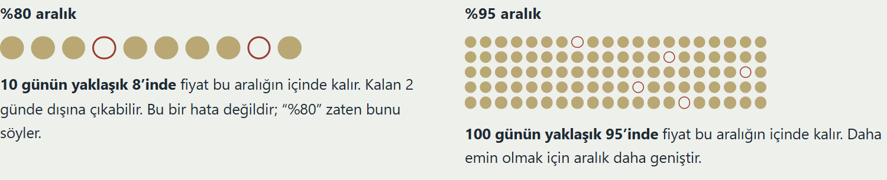
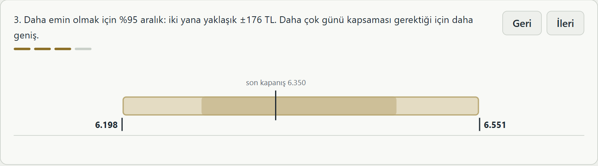

# Gram Altın Fiyat Aralığı Tahmini

**Ara rapor — 31 Ekim 2026**

Fatma Betül Pehlivan · Selçuk Üniversitesi Bilgisayar Mühendisliği · github.com/03betulpehlivan/turkey-gold-price-forecast

---

## 1. Kısaca

Bu proje, gram altının **1, 3 ve 5 işlem günü sonra hangi fiyat aralığında olacağını** tahmin ediyor ve bu tahminlerin ne kadar tuttuğunu açıkça gösteriyor.

Gerçek bir örnek:

> 20 Ekim 2026 kapanışı 6.560 TL.
> Sistem, bir sonraki işlem günü (21 Ekim) için şunu söyledi: **%80 olasılıkla 6.490 – 6.675 TL**, **%95 olasılıkla 6.414 – 6.753 TL** arasında.
> 21 Ekim kapanışı **6.575 TL** oldu; iki aralığın da içinde kaldı.

Üç ana sonuç:

1. **Tahminler söylediği kadar tutuyor.** Sistem, hiç görmediği 2023–2026 döneminde (yaklaşık 940 işlem günü) "%95" dediği aralıkların **%94,7 – %96,2'sinde** haklı çıktı.
2. **Basit yöntemden daha faydalı.** Aynı "%80" iddiasıyla, basit bir yöntemin verdiği aralıktan **%25 – %29 daha dar** aralıklar veriyor. Bu fark tesadüf değil.
3. **Fiyatın yönü tahmin edilemiyor.** "Yarın altın yükselecek mi?" sorusunda hiçbir model yazı-turadan iyi olmadı. Bu yüzden sistem yön değil, **aralık** tahmin ediyor.

## 2. Temel kavramlar

Raporun geri kalanı bu birkaç kavrama dayanıyor.

**Aralık.** İki fiyat arasındaki bölge. Sistem "yarın altın 6.400 TL olacak" demez; "yarın fiyat büyük olasılıkla 6.277 ile 6.469 TL arasında olacak" der.

**%80 aralık.** 10 benzer günün yaklaşık 8'inde fiyatın içinde kalması beklenen aralık. Kalan 2 günde fiyatın dışarı çıkması bir hata değildir; "%80" zaten bunu söyler. Hava durumu gibi: "%80 olasılıkla yağmur" denen 10 günün 2'sinde yağmur yağmaz.

**%95 aralık.** 100 benzer günün yaklaşık 95'inde tutması beklenen aralık. Daha emin olmak için daha geniştir.

Web arayüzünde bu iki kavram noktalarla anlatılıyor: dolu nokta fiyatın aralık içinde kaldığı günü, boş nokta dışına çıktığı günü gösteriyor.



**Neyi ölçüyorum?** İki şeyi birlikte:

- **Tutma oranı:** "%80" dediği aralık gerçekten günlerin yaklaşık %80'inde tuttu mu?
- **Genişlik:** Aralık ne kadar dar? "Yarın 1.000 ile 20.000 TL arası" her zaman tutar ama hiçbir bilgi vermez.

İyi bir sistem, söylediği kadar tutan **en dar** aralığı verir.

**Aralık çok geniş mi?** Bunu tutma oranı söyler. Aralık gereğinden genişse "%80" dediği hâlde %90 tutar; gereğinden darsa %70 tutar. Bu sistemin "%80" aralığı sınav döneminde 1 gün için %77,3, 3 ve 5 gün için %84 tuttu. Yani 1 günde hedefin biraz altında (biraz dar), 3 ve 5 günde biraz üstünde (biraz geniş, yani temkinli). Karşılaştırdığım basit yöntem ise "%80" dediği hâlde %87 – %92 tuttu; yani gereğinden genişti.

**Aralık neye göre belirleniyor?** Fiyatın son günlerde ne kadar inip çıktığına. Bu oynamaya **oynaklık** denir. Sakin dönemde aralık dar, çalkantılı dönemde geniştir. Örneğin ertesi gün için %80 aralık, en sakin yıl olan 2012'de ortalama fiyatın %2,2'si kadar genişti; en çalkantılı yıl olan 2023'te %4,3'ü kadar.

**Merkez tahmin.** %80 aralığın tam ortası. Tek bir fiyat isteyenler için verilir, ama yön tahmin edilemediği için her gün bir miktar sapar (bölüm 7).

**Hazırlık dönemi ve sınav dönemi.** Bir öğrenci önce eski sınav sorularıyla çalışır ve hangi yöntemin işe yaradığına karar verir; sonra hiç görmediği sorularla sınava girer. Bu projede:

| Dönem | Ne için kullanıldı? |
| --- | --- |
| **Hazırlık dönemi** (2012–2022) | Bütün modeller denendi ve en iyisi seçildi. |
| **Sınav dönemi** (2023–2026) | Seçilen model bu yılları hiç görmeden sınandı. |

Raporda "sınav sonucu" denen her sayı 2023–2026'dan gelir.

**İşlem günü.** Fiziki altın piyasasında kapanış fiyatı oluşan gün. Hafta sonu, resmî tatiller ve **arife günleri** sayılmaz; arifede fiziki piyasada kapanış oluşmuyor (2024–2026'daki yedi arifenin hiçbirinde veri yok). "3 gün sonra", 3 işlem günü sonra demektir.

## 3. Neden aralık tahmini?

Projenin ilk aşamasında yarınki fiyatı ve yönünü tahmin etmeye çalıştım. Doğrusal model, XGBoost ve LSTM gibi yöntemleri dikkatli testlerle sınadım. Hiçbiri "yarın = bugün" diyen en basit tahminden belirgin biçimde iyi olmadı. Yön tahmininde isabet %51 – %53 kaldı; yazı-turada bu oran %50.

Bunun nedeni şu: altın dünyanın en çok işlem gören varlıklarından biri. Fiyatın yarın yükseleceği bugünden bilinseydi, herkes bugün alırdı ve fiyat hemen bugün yükselirdi. Bu yüzden günlük yön büyük ölçüde rastgeledir.

Ama fiyatın **ne kadar oynayacağı** tahmin edilebiliyor. Altında çalkantılı günler art arda gelir: bugün sert hareket ettiyse, yarın da sert hareket etme olasılığı yüksektir. Sistem bunu kullanarak "fiyat şu iki değer arasında olacak" diye bir aralık veriyor.

## 4. Sistem nasıl çalışıyor?

Dört adım:

1. **Son 3 yıla bakar.** Son 750 işlem gününün (yaklaşık 3 yıl) kapanış fiyatlarını kullanır. Model her ayın başında bu pencereyle yeniden kurulur; pencere her ay bir ay ileri kayar.
2. **Oynaklığı tahmin eder.** Fiyatın önümüzdeki günlerde tipik olarak ne kadar inip çıkabileceğini hesaplar. Buna "tipik hareket" diyelim.
3. **Aralığa çevirir.** Tipik hareketi aralığın ortasının iki yanına koyar: %80 aralık için yaklaşık **1,1 katı**, %95 aralık için yaklaşık **2 katı**. Altında büyük sıçramalar, normal dağılımın beklediğinden daha sık olur; model bu katsayıları her ay geçmiş veriden yeniden hesaplar.
4. **Gerçekle karşılaştırır.** Gün bitince gerçek kapanış fiyatı aralığın içinde mi diye bakılır.

Bugünkü örnek: 30 Ekim kapanışı 6.350 TL. Bir sonraki işlem günü (2 Kasım) için %80 aralık **6.277 – 6.469 TL**, yani ortadan iki yana yaklaşık ±96 TL.

Web arayüzünde bu adımlar bugünün gerçek sayılarıyla animasyon olarak gösteriliyor. Aşağıdaki görüntü 3. adım: önce %80 aralık konuyor, sonra daha emin olmak için %95 aralığa genişliyor.



## 5. Nasıl test ettim?

Bir tahmin sisteminin gerçekten işe yarayıp yaramadığını anlamak için, onu **geleceği bilmediği** bir durumda sınamak gerekir. Bunun için şu kuralları koydum:

- **Model her zaman yalnızca geçmişi görür.** Her tahmin, o güne kadarki fiyatlarla yapılır; o günden sonraki hiçbir fiyatı görmez.
- **Hazırlık ve sınav ayrı.** Model 2012–2022'de seçildi; 2023–2026'yı hiç görmeden sınandı.
- **Sınav dönemini sonuçlara bakmadan seçtim.** 2023–2026, en son dönem olduğu için seçildi. Sakin yılları seçseydim sonuçlar daha iyi görünürdü; ama bu, kolay soruları seçip sınava girmek gibi olurdu. Ayrıca kullanıcı sisteme en çok çalkantılı dönemlerde ihtiyaç duyar.
- **Veri uydurulmaz.** Tatil ve arife günleri için fiyat uydurulmaz; pandemi gibi olağanüstü günler silinmez.
- **Kötü sonuçlar da yazılır** (bölüm 10).

## 6. Model yarışması

16 model, hazırlık döneminde yarıştı. Her model her ay yalnızca o güne kadarki fiyatlarla yeniden kuruldu ve 1, 3, 5 gün sonrası için aralık verdi.

**Kural:** Önce tutma oranına bakılır. %80 aralığı 77 – 83 arasında, %95 aralığı 93 – 97 arasında tutmayan model **elenir**. Kalanlar arasında **puanı en düşük** olan kazanır. Puan, aralığın hem genişliğini hem de ıskaladığı günleri cezalandırır; yani hem dar hem isabetli olmayı birlikte ister ve çok geniş aralık vererek kandırılamaz.

**1 gün sonrası için hazırlık dönemi sonuçları** (3 ve 5 gün için tablolar web arayüzünde):

| Model | Ne yapar? | %80 aralık tuttu | %95 aralık tuttu | Puan | Durum |
| --- | --- | --- | --- | --- | --- |
| **ARIMA-GARCH** | GARCH-t'ye bir önceki günün değişiminin etkisini ekler | 78,6 | 94,9 | 11,71 | **Kazanan** |
| GARCH-t | Oynaklığı her gün güncelleyen klasik istatistik modeli | 78,2 | 94,9 | 11,71 | Kazananla neredeyse aynı |
| GARCH-t + Fed günleri | Fed karar günlerinde aralığı genişletir | 78,4 | 95,0 | 11,72 | Neredeyse aynı |
| Birleşim (3 model) | GARCH-t, EWMA ve geçmiş benzer günlerin ortalaması | 80,2 | 95,0 | 11,79 | %0,7 kötü |
| GARCH-t + ayar | Aralık ıskaladıkça genişleyen otomatik ayar | 80,0 | 95,0 | 11,79 | %0,7 kötü |
| GJR-GARCH | Düşüşlere ayrı tepki veren GARCH | 78,3 | 94,6 | 11,84 | %1,2 kötü |
| HAR | Son günün, haftanın ve ayın oynaklığını birleştirir | 79,0 | 94,2 | 12,04 | %2,8 kötü |
| Rejim (Markov) | Piyasayı sakin ve çalkantılı iki duruma ayırır | 78,9 | 94,3 | 12,17 | %3,9 kötü |
| EWMA | Yakın günlere daha çok ağırlık veren oynaklık ortalaması | 81,9 | 94,0 | 12,19 | %4,1 kötü |
| EWMA + ayar | EWMA'ya otomatik ayar | 80,2 | 94,9 | 12,27 | %4,8 kötü |
| Geçmiş benzer günler | Son 3 yılda yaşanmış değişimleri olduğu gibi kullanır | 78,8 | 94,6 | 12,74 | %8,8 kötü |
| ARIMA-GARCH + Chronos | İstatistik modeli ile yapay zekânın ortalaması | 83,3 | 96,0 | 11,66 | Elendi (%80 aralık fazla tuttu) |
| Chronos | Amazon'un hazır yapay zekâ modeli | 85,1 | 95,7 | 12,37 | Elendi (fazla tuttu) |
| XGBoost | Makine öğrenmesi; aralık sınırlarını doğrudan öğrenir | 74,2 | 91,9 | 12,41 | Elendi (az tuttu) |
| Sabit aralık | Son 3 yılın ortalama hareketi; karşılaştırma için basit yöntem | 83,9 | 94,6 | 12,86 | Elendi (fazla tuttu) |
| HAR-X | HAR'a dış piyasa verisi ekler (GVZ, VIX, dolar/TL, Brent) | 76,3 | 92,3 | 13,18 | Elendi (az tuttu) |

İlginç bir nokta: 1 gün için puanı en düşük olan model aslında ARIMA-GARCH + Chronos. Ama %80 aralığı %83,3 tuttuğu için, yani söylediğinden biraz geniş olduğu için elendi. Kural önceden konduğu için uygulandı.

**Kazananlar:**

| Tahmin | Kazanan model |
| --- | --- |
| 1 gün sonra | ARIMA-GARCH |
| 3 gün sonra | ARIMA-GARCH + Chronos (istatistik ve yapay zekâ birlikte) |
| 5 gün sonra | ARIMA-GARCH + Chronos |

Kronos (finans için hazırlanmış başka bir yapay zekâ modeli) bu tabloya girmedi; ayrı ve daha küçük bir denemede sınandı (bölüm 10).

Web arayüzündeki "Kim kazandı?" görünümü aynı sonucu çubuklarla gösteriyor: her çubuk, modelin kazanandan ne kadar kötü olduğunu gösteriyor; elenen modeller en altta, elenme nedeniyle birlikte.


## 7. Sonuç: sınav döneminde ne oldu?

Kazanan modeller 2023–2026'da şu sonuçları verdi:

| Tahmin | "%95" dediği aralık tuttu | "%80" dediği aralık tuttu | Basit yönteme göre | Sınanan gün |
| --- | --- | --- | --- | --- |
| 1 gün sonra | **%94,7** | %77,3 | %12,9 daha iyi (p = 0,0005) | 944 |
| 3 gün sonra | **%96,2** | %84,3 | %13,2 daha iyi (p < 0,0001) | 942 |
| 5 gün sonra | **%96,2** | %84,0 | %10,0 daha iyi (p = 0,0018) | 940 |

"Daha iyi" oranı, bölüm 6'daki puana göre hesaplandı. p değeri, farkın tesadüfen çıkma olasılığıdır; üç ufukta da 0,01'in altında, yani fark tesadüf değil.

Kullanıcı için anlamı şu grafikte:


Örneğin 1 gün sonrası için, 6.560 TL'lik bir fiyatta basit yöntemin %80 aralığı ortalama **356 TL** genişliğinde ve günlerin %87,1'inde tuttu. Bu sistemin %80 aralığı ise **252 TL** genişliğinde ve %77,3 tuttu. Basit yöntem daha sık tutuyor, çünkü söylediğinden geniş; bu sistem ise "%80" iddiasına daha yakın ve yaklaşık %29 daha dar bir aralıkla daha net bilgi veriyor.

**Zayıf yanlar:**

- Ertesi gün için "%80" dediği aralık %77,3 tuttu; hedefin biraz altında. En zayıf yıl 2023 (%71,3). O yıl fiziki altın, uluslararası fiyattan beklenmedik biçimde ayrıştı.
- 3 ve 5 günde "%80" dediği aralık %84 tuttu; aralık gerekenden biraz geniş. Bu, ters yönde hata yapmaktan, yani aralığın tutmamasından iyidir.

**Tek bir fiyat tahmini de verilebilir mi?**

Aralığın ortası tek bir "merkez tahmin" olarak kullanılabilir. Aralık, gerçekleşen fiyat ve son günün hareketiyle daha karmaşık bir formül de aradım; hazırlık döneminde hiçbir bilgi belirgin bir katkı yapmadı. Sınav döneminde merkez tahminin ortalama sapması:

| Tahmin | Merkez tahmin | "Yarın = bugün" |
| --- | --- | --- |
| 1 gün sonra | 84 TL | 85 TL |
| 3 gün sonra | 129 TL | 131 TL |
| 5 gün sonra | 161 TL | 169 TL |

Merkez tahmin "yarın = bugün"den yalnızca biraz iyi, çünkü altının yönü tahmin edilemiyor. Bu yüzden ekranda merkez tahmin ortalama sapmasıyla birlikte, ikincil bilgi olarak gösteriliyor; asıl bilgi aralık.

## 8. Kriz yıllarında ne oldu?

Altın fiyatı her yıl aynı davranmıyor. Bir tahmin sisteminin asıl sınavı, çalkantılı dönemlerde de çalışıp çalışmadığıdır.

Sistem, son günlerde fiyatın ne kadar oynadığına bakıyor. Fiyat sert hareket etmeye başlarsa aralığı kendiliğinden **genişletiyor**; ortalık sakinleşince yeniden **daraltıyor**. Deneyimli bir sürücü gibi: yağmurda yavaşlar, yol kuruyunca hızlanır. Basit yöntem ise son 3 yılın ortalamasına baktığı için havaya geç uyuyor: krizi geç fark ediyor, kriz geçince de uzun süre geniş kalıyor.


- **Üst grafik:** bu sistemin aralığı sakin yıllarda fiyatın yaklaşık %2,3'ü kadarken, 2021 kur krizinde %3,8'e çıktı; kriz geçince 2022'de %3,3'e indi. Basit yöntemin aralığı ise 2022'den sonra %5 – %6'ya çıktı ve orada kaldı.
- **Alt grafik:** bu sistem çoğu yıl hedefe (%80) yakın kaldı. Basit yöntem 2024–2026'da %88 – %91 tuttu. İlk bakışta iyi görünse de bu, aralığının gereğinden geniş olduğu anlamına geliyor. Dürüst olmak gerekirse, ani şok yılı 2023'te geniş aralığı sayesinde basit yöntem daha sık tuttu (%78,9'a karşı %71,3).

**Yıllara göre sonuçlar** (ertesi gün tahmini, ARIMA-GARCH):

| Yıl | Ne oldu? | "%80" dediği aralık tuttu | "%95" dediği aralık tuttu |
| --- | --- | --- | --- |
| 2012–2017 | Görece sakin | %76 – %84 | %95 – %96 |
| 2018 | TL krizi | %75,5 | %92,8 |
| 2020 | Pandemi şoku | %71,2 | %91,6 |
| 2021 | Kur krizi | **%80,9** | **%95,5** |
| 2022 | | %80,4 | %95,6 |
| 2023 | Fiziki altında prim kırılması | %71,3 | %91,2 |
| 2024 | | %79,8 | %95,1 |
| 2025 | | %79,9 | %97,2 |
| 2026 (Ekim ortasına kadar) | | %78,7 | %95,4 |

**Bu tablodan çıkan sonuçlar:**

1. **Süren çalkantıyı iyi idare ediyor.** 2021'de TL çok sert değer kaybetti, ama sistem aralığı zamanında genişleterek hedefi tutturdu.
2. **Ani şoklarda zorlanıyor ama çökmüyor.** 2020 Mart'ındaki pandemi çöküşü ve 2023'te fiziki altının uluslararası fiyattan birden ayrışması gibi olaylarda tutma oranı %71'e düştü. Bu tür olaylar geçmiş veride görülmediği için hiçbir modelin önceden bilmesi beklenemez. Yine de "%95" dediği aralık bu yıllarda bile %91 – %93 tuttu.
3. **Kriz sonrasında hızla toparlanıyor.** 2023'ten sonra 2024 ve 2025'te yeniden hedefe döndü.

## 9. Veri ve incelemeler

**Hangi verileri kullandım?**

| Veri | Kaynak | Ne için? |
| --- | --- | --- |
| Gram altın kapanışı (TL/gram) | TCMB EVDS: İstanbul Altın Borsası arşivi (1995–2018) ve Borsa İstanbul Kıymetli Madenler Piyasası (2018'den bugüne) | Ana veri; tahminler bununla yapılır |
| Ons altın, gümüş, Brent petrol | Yahoo Finance | Dış piyasa denemeleri |
| Dolar/TL, Euro/TL, dolar endeksi | Yahoo Finance | Kur etkisi denemeleri |
| ABD 10 yıllık faizi, VIX, GVZ, S&P 500, BIST 100 | Yahoo Finance | Piyasa korkusu ve borsa denemeleri |
| Enflasyon (TÜFE), politika faizi | TCMB EVDS (aylık) | Makro denemeler |
| Fed faiz kararı günleri | ABD Merkez Bankası takvimi | 2012–2026, 119 planlı karar günü |

EVDS seri kodları: TP.MK.T.KAP.Y (1995–2018) ve TP.ALTINPIYASA.KAP02 (2018 sonrası); TL/kg değeri 1000'e bölünerek TL/gram yapıldı. VIX borsa korku endeksi, GVZ ise altının beklenen oynaklığıdır.

**Veriyle ilgili kurallar:**

- **2009 sonrası kullanıldı.** Eski yıllarda tutarsızlıklar var; 2005'te TL'den 6 sıfır atıldı. Model zaten son 3 yıla bakıyor.
- **Eksik gün doldurulmaz.** Tatil ve arife günleri için fiyat uydurulmaz; yalnızca işlem olan günler sırayla kullanılır.
- **Olağanüstü gün silinmez.** Pandemi gibi sert günler veride kalır.
- **Yayın gecikmesi hesaba katılır.** TCMB kapanışı bir sonraki iş günü yayımlıyor; dış verilerde en fazla 10 günlük eski değer kullanılır.

**Neleri inceledim, ne buldum?** (hepsi hazırlık dönemi verisiyle)

| İnceleme | Bulgu |
| --- | --- |
| Oynaklık tahmin edilebilir mi? | Evet. GARCH modeli 11 yılın 10'unda "oynaklık hep aynı" varsayımından iyi çıktı. Sistemin temeli bu. |
| Altının korku endeksi (GVZ) | 2018 ve 2021 TL krizlerinde işe yaramadı; Türkiye'ye özgü kur şoklarını görmüyor. |
| Fiziki prim (gram fiyatı ile "ons × dolar/TL" farkı) | Normalde yaklaşık yarım haftada kapanıyor. 2023'ten sonra kalıcı bir prim oluştu; daha önce hiç görülmemişti. |
| Gece bilgisi (borsa kapandıktan sonra dünyada olanlar) | Hazırlık döneminde "yarın = bugün"den iyi göründü; 2023'teki prim kırılmasıyla bozuldu, sınav döneminde %9 kötü çıktı. |
| Enflasyon ve faiz | Ek bilgi taşımadı. |
| Dış piyasa oynaklıkları (HAR-X) | Modeli iyileştirmedi, biraz kötüleştirdi. |
| Fed karar günleri | Fark yaratmadı; model olaydan sonra zaten hızla uyum sağlıyor. |
| Ne kadar süre test gerekir? | 120 günlük bir canlı testle ancak yaklaşık %20'lik büyük farklar güvenle görülebiliyor. Bu yüzden asıl değerlendirme uzun sınav döneminde yapıldı. |

## 10. Denediğim ama işe yaramayanlar

Olumsuz sonuçları da raporluyorum, çünkü neyin işe yaramadığını bilmek de önemli.

| Ne denedim? | Sonuç |
| --- | --- |
| Fiyatın yönünü tahmin etmek (doğrusal model, XGBoost, LSTM, gece bilgisi) | Yazı-turadan iyi değil (%51 – %53). |
| Yarının tam fiyatı | Sınav döneminde hiçbir model "yarın = bugün"den belirgin biçimde iyi olmadı. |
| Literatürdeki %99 başarı | Bazı çalışmalarda LSTM %99,9 başarılı görünüyor. Aynı kurulumu denedim: veri karıştırılarak bölününce gerçekten %99,9 çıkıyor, çünkü model geleceği "görüyor". Doğru kurulumda "yarın = bugün"den %73 kötü. |
| Makine öğrenmesiyle aralık (XGBoost) | Aralıkları fazla dar; "%80" dediği %74 – %76 tuttu. |
| Dış piyasa verisi ve Fed günleri | Aralıkları iyileştirmedi (bölüm 9). |
| Kronos (finans için hazır yapay zekâ modeli) | 1 günde hazırlık döneminde ARIMA-GARCH'tan %40 kötü, sınav döneminde yaklaşık eşit; 3 ve 5 günde aralıkları fazla dar. Kronos mum grafiğiyle (açılış, en yüksek, en düşük, kapanış) eğitilmiş; bizde yalnızca kapanış fiyatı var. |

**İşe yarayan:** oynaklığı tahmin etmek. Klasik istatistik modeli ARIMA-GARCH ve yapay zekâ modeli Chronos en iyi sonucu verdi.

## 11. İleriye dönük karne

Yukarıdaki sonuçlar geriye dönük hesaplandı: her gün için model yalnızca o güne kadarki fiyatları gördü, ama hesap sonradan yapıldı. Daha güçlü bir kanıt için sistem **21 Ekim 2026'dan beri her sabah** 1, 3 ve 5 günlük aralıklarını, gerçek fiyat belli olmadan önce değiştirilemez biçimde kaydediyor. Fiyat gelince kayıt kendiliğinden puanlanıyor.

30 Ekim kapanışı itibarıyla:

| Tahmin | Sonuçlanan | %80 aralık tuttu | %95 aralık tuttu |
| --- | --- | --- | --- |
| 1 gün sonra | 4 | 3 | 4 |
| 3 gün sonra | 2 | 1 | 2 |
| 5 gün sonra | 1 | 0 | 1 |

Bu sayılar yorum yapmak için henüz çok az; karne birkaç ay içinde anlam kazanacak.

## 12. Kullanıcı ne görüyor?

Sistemin bir web arayüzü var. Teknik bilgisi olmayan bir kullanıcının anlayabilmesi için her kavram sade bir dille ve animasyonlarla anlatılıyor:

1. **Bugünkü tahmin:** "1, 3, 5 gün sonra" ve "%80 / %95" düğmeleri. Fiyat cetveli üzerindeki aralık, düğmeye basınca animasyonla genişliyor ya da daralıyor. Altında sade bir cümle: "10 benzer günün yaklaşık 8'inde fiyat bu aralıkta kalır."
2. **Aralık ne demek?** Hava durumu benzetmesi, 10 ve 100 noktalık animasyonlar, sakin ve çalkantılı yıl karşılaştırması, "Aralık çok geniş değil mi?" sorusunun cevabı.
3. **Tahminler tuttu mu?** Sınav dönemi sonuçları; son 15 günü tek tek oynatan animasyon; her günün aralığı ve gerçekleşen fiyat; merkez tahminin kaç TL saptığı ("87 TL eksik", "93 TL fazla"); bu yılın tamamı; ileriye dönük karne.
4. **Kriz yılları** grafiği.
5. **Nasıl çalışıyor?** Bugünün gerçek sayılarıyla adım adım animasyon; hazırlık ve sınav dönemi açıklaması.
6. **Model yarışması:** "Kim kazandı?" animasyonu ve 16 modelin tam tablosu.
7. **Veri ve incelemeler**, **denenenler** ve **sözlük**.
8. "Bu bir yatırım tavsiyesi değil, istatistiksel bir risk aralığıdır" notu.

**Ana ekran (bugünkü tahmin):**


**Son 15 işlem günü:** her gün için bir gün önce verilen %80 aralık ve gerçekleşen fiyat. Yeşil kutular tutan, turuncu kutular %80 aralığın dışında kalıp %95 aralığın içinde kalan günler. "Oynat" düğmesi günleri tek tek gösteriyor.


## 13. Sistemin teknik yapısı (kısaca)

- **Veri:** fiziki gram altın kapanışları TCMB EVDS'den, ons ve kur fiyatları Yahoo Finance'tan.
- **Otomatik çalışma:** bilgisayar her iş günü 12:30'da kendiliğinden yeni veriyi indiriyor, tahmini kaydediyor ve sonuçları GitHub'a gönderiyor. Bilgisayar geç açılırsa görev açılışta çalışıyor (14:00'e kadar).
- **Veritabanı ve arayüz:** Microsoft SQL Server, FastAPI ile yazılmış bir REST API ve web arayüzü.
- **Güvenilirlik:** 700'den fazla otomatik test; kayıtların değiştirilmediğini her gün kontrol eden bir denetim; görev çalışmazsa e-posta gönderen bir bekçi.

## 14. Sınırlar

- Fiziki fiyat, Borsa İstanbul'daki toptan fiyattır; kuyumcu fiyatını kapsamaz.
- Sistem yön tahmin etmez; yalnızca aralık verir.
- Arife günlerinde fiziki piyasada kapanış oluşmuyor; bu günler veride yok. Ekrandaki hedef tarihler için tatil listesi her yıl güncellenmeli (2027'nin dini bayram tarihleri henüz eklenmedi).
- 2023–2026 sonuçlarını yarışmaya yeni modeller eklerken birkaç kez gördüm. Bu yüzden en temiz kanıt, **ileriye dönük karne** olacak.
- Araştırma ve eğitim amaçlıdır; yatırım tavsiyesi değildir.

## 15. Gelecek çalışmalar

1. **İleriye dönük karnenin büyümesi.** Birkaç ay içinde biriken kayıtlarla sistemin gerçek ileriye dönük başarısı ölçülecek.
2. **TL'ye özgü olay günleri.** Fed günleri bir şey katmadı. TL bazında altın için TCMB faiz kararları ve Türkiye enflasyon verisi daha etkili olabilir.
3. **Mum grafiği verisi.** Gün içi veriyle (açılış, en yüksek, en düşük) Kronos gibi modeller adil biçimde yeniden sınanabilir.
4. **Yeni yapay zekâ modelleri.** Chronos-2 ve Google'ın TimesFM modeli aynı yarışmayla denenebilir.
5. **Kullanıcı özellikleri.** Herkese açık bir web sayfası, hareketli gün bildirimi, çeyrek ve Cumhuriyet altını gibi farklı ürünler.

---

## Ek A: Kısa sözlük

| Terim | Anlamı |
| --- | --- |
| Aralık | Fiyatın büyük olasılıkla içinde kalacağı iki sayı arası |
| %80 / %95 aralık | 10 günün 8'inde / 100 günün 95'inde tutması beklenen aralık |
| Tuttu / tutmadı | Gerçekleşen kapanış aralığın içinde mi, dışında mı |
| Oynaklık | Fiyatın ne kadar inip çıktığı |
| Merkez tahmin | %80 aralığın tam ortası |
| İşlem günü | Kapanış fiyatı oluşan gün (hafta sonu, tatil ve arife hariç) |
| Sabit aralık | Son 3 yılın ortalama hareketine bakan basit karşılaştırma yöntemi |
| Puan | Aralığın genişliğini ve ıskaladığı günleri birlikte ölçen sayı; düşük olan iyi |
| Hazırlık dönemi | 2012–2022: modellerin denendiği ve seçildiği yıllar |
| Sınav dönemi | 2023–2026: seçilen modelin hiç görmeden sınandığı yıllar |
| p değeri | Bir farkın tesadüfen çıkma olasılığı; 0,05'ten küçükse fark tesadüf sayılmaz |
| İleriye dönük karne | Fiyat belli olmadan önce kaydedilen ve sonra puanlanan gerçek tahminler |

## Ek B: İlk aşamanın grafikleri

Projenin ilk aşamasında yön tahminini ve oynaklığı ayrıntılı inceledim. Bu grafikler o çalışmaya ait; açıklamalar web arayüzündeki "Ayrıntılı araştırma panosu" sayfasında.

**Bağımsız sınavlar:** yön tahmini üç ayrı sınavda da "yarın = bugün"den iyi olmadı.


**Literatürdeki yüksek başarılar neden yanıltıcı:** yanlış ölçüldüğünde "yarın = bugün" bile %99,9 başarılı görünüyor.


**Oynaklık tahmin edilebiliyor:** GARCH modeli 11 yılın 10'unda sabit oynaklık varsayımını geçti.


**Fiziki prim:** 2023'e kadar fiziki ve uluslararası fiyat arasındaki fark sıfıra yakındı.


**Güç analizi:** 120 günlük bir değerlendirmenin hangi büyüklükte farkı görebileceği.


## Ek C: Gösterim komutları

```powershell
powershell -NoProfile -ExecutionPolicy Bypass -File scripts\pano.ps1    # web arayüzü: http://127.0.0.1:8000
python -m src.live.physical_forecast refresh                            # en güncel fiyatı elle indir
python -m src.tool.yarisma --chronos                                    # model yarışması (10-15 dakika)
python -m src.tool.canli_karne karne                                    # ileriye dönük karne
python -m src.report_figures                                            # rapor grafiklerini yeniden çiz
python -m src.ekran_goruntuleri                                         # arayüz görüntülerini yeniden al (pano açıkken)
python -m unittest discover -s tests                                    # bütün testler
```
