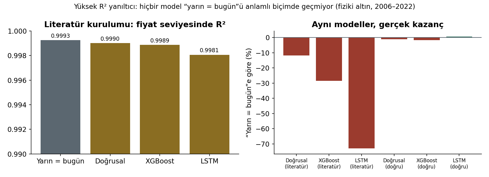
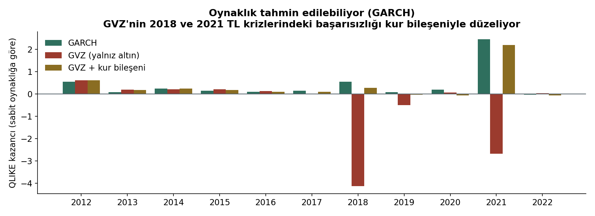
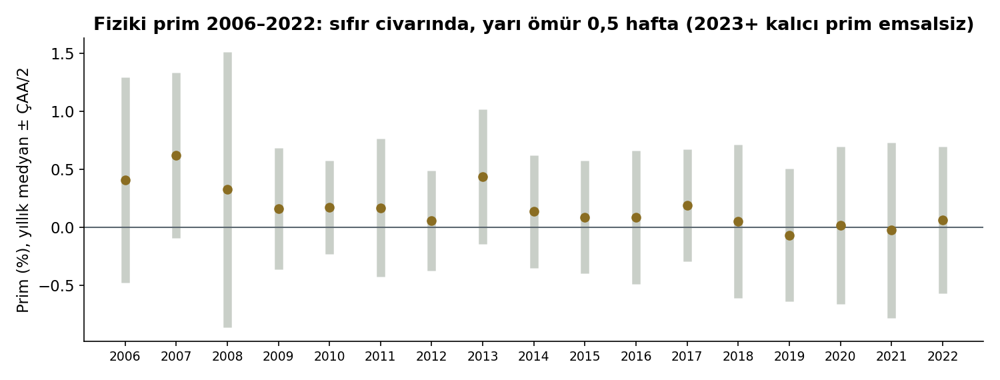
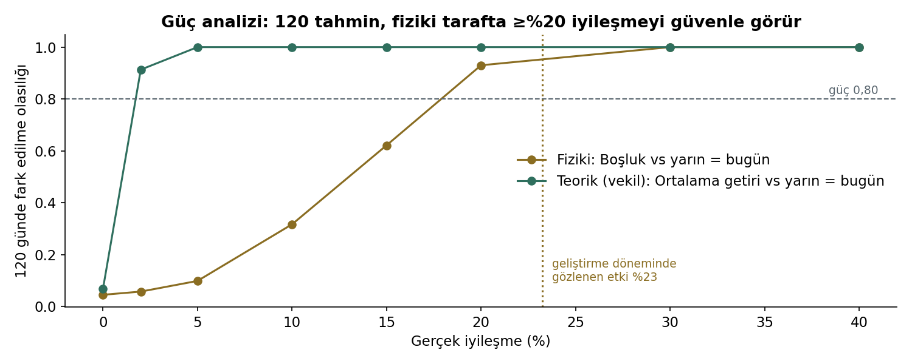

# Türkiye'de Gram Altın Fiyatlarının Makine Öğrenmesi Tabanlı Tahmini ve Analiz Sistemi

**Ara rapor — 17 Ekim 2026**

Fatma Betül Pehlivan · Selçuk Üniversitesi Bilgisayar Mühendisliği · github.com/03betulpehlivan/turkey-gold-price-forecast

---

## Özet

Bu proje, Türkiye'deki **fiziki** gram altın fiyatı (Borsa İstanbul) ile ons altın ve USD/TRY'den hesaplanan **teorik** gram fiyatı için kısa vadeli tahmin üretir, tahminlerin belirsizliğini ölçer ve bütün sonuçları **sızıntısız, önceden kayıtlı ve bağımsız** testlerle değerlendirir. Bunların üzerine her gün kendiliğinden çalışan bir canlı tahmin sistemi, SQL Server veritabanı, REST API ve web panosu kuruldu.

**Ana bulgular:**

1. **Günlük fiyat yönü ve seviyesi, "yarın = bugün" yönteminden (RW) anlamlı biçimde daha iyi tahmin edilemiyor.** Üç bağımsız sınavın hiçbirinde model RW'yi geçemedi. Teorik fiyatta pratikte eşdeğer, fiziki fiyatta 2023–2026'da daha kötü sonuç verdi.
2. **Literatürdeki yüksek başarı oranları büyük ölçüde değerlendirme hatalarından kaynaklanıyor.** Aynı veriyle, fiyat seviyesinde ölçülen R² "yarın = bugün" için bile 0,999 çıkıyor. Doğru kurulumda LSTM dahil hiçbir model RW'yi anlamlı biçimde geçmiyor.
3. **Tahmin edilebilir olan şey oynaklık.** GARCH, oynaklığı sabit sayan modeli 11 yılın 10'unda geçiyor ve tahmin aralıklarının ihlallerini kümelenmekten kurtarıyor.
4. **Fiziki fiyat için gerçek bir bilgi kaynağı bulundu, ama kırılgan.** Gece gelen ons ve kur hareketi 2012–2022'de hatayı %22 azalttı. Ancak 2023'ten sonra fiziki prim kalıcı biçimde açıldı ve bu ilişki bozuldu. Prim, 2006–2022 boyunca hep sıfır civarında kalmıştı (yarı ömür 0,5 hafta); bu kırılmanın geçmişte bir emsali yok.
5. **Veri kaynağında ciddi sorunlar tespit edildi.** Yahoo Finance günlük verisinde ons ve kur 13–16 saat farklı anlara ait. Vadeli ons serisinde sahte sıçramalar var. 2005–2010 kur verisi geleceği sızdırıyor.
6. **Canlı sistem 15 Ekim 2026'dan beri çalışıyor.** Dört protokol önceden kayıtlı kurallarla kayıt tutuyor. 120 tahmin dolunca (yaklaşık Nisan 2027) değerlendirme bir kez yapılacak. Güç analizine göre bu örneklem, fiziki tarafta %20 ve üzeri bir iyileşmeyi güvenle görebilir.


---

## 1. Problem ve motivasyon

Gram altın Türkiye'de en yaygın birikim araçlarından biri. Fiyatı esas olarak uluslararası ons fiyatına ve USD/TRY kuruna bağlı, ama yurt içi fiziki piyasa zaman zaman uluslararası fiyattan ayrışıyor.

Literatürde altın fiyatını yüksek doğrulukla tahmin ettiğini söyleyen çok sayıda çalışma var (23 çalışmalık literatür taraması: `Literatur_Taramasi_Raporu_Gram_Altin.pdf`). Bu çalışmaların çoğu rastgele bölme, bütün veriyle ölçekleme ve fiyat seviyesinde R² gibi, geleceği farkında olmadan modele sızdıran yöntemler kullanıyor. Bu projenin çıkış noktası şu soru oldu: **Bu başarılar, gerçek bir tahmin ortamında, yani yalnızca o gün bilinebilen bilgiyle de geçerli mi?**

Bu yüzden projede yöntemsel titizlik, model karmaşıklığından önce geliyor. Her sonuç, türüyle birlikte raporlanıyor:

- **Keşif:** geliştirme verisi; model seçimi burada yapılır; kanıt değeri sınırlıdır.
- **Bağımsız sınav:** önceden kayıtlı, tek seferlik, hiç görülmemiş veri.
- **Canlı:** ileriye dönük, değiştirilemez kayıt.

## 2. Araştırma soruları ve hipotezler

| Soru | Hipotez | Test | Durum |
| --- | --- | --- | --- |
| **S1.** Günlük teorik fiyat RW'den iyi tahmin edilebilir mi? | Model RW'den daha az hata yapar | `FINAL_EXAM_V1` (2026, bağımsız) | **Desteklenmedi:** pratikte eşdeğer (+%0,2 [−1,2, +1,3]) |
| **S2.** Gece bilgisi fiziki fiyatı tahmin etmeye yardım eder mi? | Boşluk modeli RW'den daha az hata yapar | `FINAL_EXAM_PHYS_V1` (2023–2026, bağımsız) | **Desteklenmedi:** RW'den %9,1 kötü [−20,8, −0,3], p = 0,03 |
| | Yalnız gece ons bilgisi, hiç görülmemiş dönemde de işe yarar | `BACK_EXAM_ONS_V1` (2001–2004, geriye dönük bağımsız) | **Desteklenmedi:** +%0,5 [−3,8, +5,1], p = 0,81 |
| **S3.** Tahmin belirsizliği güvenilir ölçülebilir mi? | Oynaklığa duyarlı aralıklar kalibre olur | Teorik: teyit testi + 2026 sınavı | Teyit testinde **desteklendi**; 2026'da %80 aralıkta ihlaller kümelendi, **desteklenmedi** |
| | Oynaklık tahmin edilebilir | Oynaklık çalışması (keşif) | **Evet:** GARCH 11 yılın 10'unda sabit oynaklığı geçiyor |
| **S4.** Sonuçlar canlı ortamda geçerli mi? | Ön kayıtlı canlı protokoller | `LIVE_PHYS_V1`, `LIVE_PHYS_INT_V1`, `LIVE_V1`, `LIVE_V2` | **Kayıt sürüyor;** değerlendirme 120 tahminden sonra |

## 3. Veri

| Veri | Kaynak | Dönem |
| --- | --- | --- |
| Fiziki altın kapanışı (TL/gr) ve Borsa İstanbul USD/ons | TCMB EVDS (İstanbul Altın Borsası arşivi 1995–2018, Borsa İstanbul 2018–) | 1995 → bugün |
| Ons (GC=F), USD/TRY ve 9 piyasa göstergesi (GVZ dahil) | Yahoo Finance, günlük | 2005 → bugün |
| Ons, USD/TRY ve GLD, saatlik | Yahoo Finance; her gün arşivleniyor | 2024-10 → bugün |
| TÜFE, TR ve ABD politika faizi | TCMB EVDS, aylık | 2004 → bugün |

Bütün indirmeler değiştirilemez anlık görüntüler olarak md5 özetiyle saklanıyor. EVDS'nin yanıtları sessizce 1.000 satırda kestiği tespit edildi; indirme bu sınıra göre otomatik bölünüyor.

**Projeye özgün veri bulguları:**

- **Zamanlama uyumsuzluğu:** Yahoo'nun günlük ons kapanışı yaklaşık 18:00 UTC'ye, USD/TRY kapanışı 02:00–05:00 UTC'ye ait. Yaygın kullanılan "teorik gram fiyatı" bu yüzden 13–16 saat farklı anların çarpımı. Proje, iki değeri aynı saatlik çubuktan alan eşzamanlı bir seri kurdu.
- **Sızıntı:** 2005–2010 Yahoo kur verisi Borsa İstanbul kapanışından **sonraki** bir saate ait. O dönemle yapılan sabah tahminleri geleceği görür; bu yıllar eğitimden çıkarıldı.
- **Vadeli kontrat sıçramaları:** GC=F, kontrat değişim günlerinde %1,5–1,9'luk sahte sıçramalar yapıyor. Önceden kayıtlı bir taramayla spot ons yerine kullanılabilecek kaynak arandı; GLD uygun bulundu ve `LIVE_V2` protokolü onunla kuruldu.

## 4. Yöntem ilkeleri

- **Zamana göre ilerleyen değerlendirme (walk-forward):** eğitim penceresi genişleyerek ilerliyor, model her 63 işlem gününde yeniden eğitiliyor. Rastgele bölme hiç kullanılmıyor.
- **Sızıntı kontrolleri:** her girdinin açık bir zaman damgası var. Otomatik testler, tahmin anında bilinmeyen bütün bilgiyi bozup tahminin değişmediğini doğruluyor.
- **Ön kayıt:** her kesin testin hipotezi, karar kuralı, kodu ve veri özetleri sonuçtan **önce** Git'e kaydediliyor. Kesin testler tek bir kez çalıştırılabiliyor; her deneme `research/registry.jsonl` dosyasına yazılıyor.
- **Kilitli kod:** canlı protokollerin kodu ön kayıtla kilitli. Kod değişirse o tahminler değerlendirmeye girmiyor.
- **Olumsuz sonuçlar saklanmıyor:** desteklenmeyen hipotezler de aynı biçimde raporlanıyor.
- **İstatistik:**
  - Nokta tahminleri: Diebold–Mariano testi (küçük örneklem düzeltmesiyle), çoklu karşılaştırmada Holm düzeltmesi, blok bootstrap güven aralıkları.
  - Aralıklar: Kupiec ve Christoffersen testleri, Winkler skoru.
  - Oynaklık: QLIKE kaybı.

## 5. Sonuçlar

### 5.1 Bağımsız sınavlar

| Sınav | Veri | Sonuç |
| --- | --- | --- |
| `FINAL_EXAM_V1` | Teorik fiyat, 2026, 194 gün | Nokta: **pratikte eşdeğer** (+%0,2 [−1,2, +1,3], p = 0,76). Aralık: Kupiec geçti, %80 aralıkta ihlaller kümelendi |
| `FINAL_EXAM_PHYS_V1` | Fiziki fiyat, 2023–2026, 874 gün | Boşluk modeli **RW'den %9,1 kötü** [−20,8, −0,3], p = 0,03 |
| `BACK_EXAM_ONS_V1` | Fiziki fiyat, 2001–2004, 497 gün (hiç kullanılmamış veri) | Gece ons bilgisi: **ayırt edilemedi** (RW'ye göre +%0,5, eğilime göre +%3,0; Holm p 0,81 ve 0,29) |

**Fiziki sınavın yorumu:** 2023–2024'te fiziki altın uluslararası fiyatın %1–5 üzerinde işlem gördü. Geçmişten öğrenilen "fiziki fiyat teorik fiyata yakınsar" ilişkisi bu dönemde bozuldu. Prim çalışması (5.5) bu durumun 2006–2022 arasında hiç görülmediğini gösteriyor.

### 5.2 Literatürdeki başarı neden yanıltıcı? (Sızıntı gösterimi, keşif)

Aynı fiziki veri (2006–2022) ve aynı modeller (doğrusal model, XGBoost, sıfırdan yazılmış LSTM, "yarın = bugün") üç farklı kurulumda değerlendirildi:

| Kurulum | "Yarın = bugün" | LSTM | Asıl soru: RW'yi geçiyor mu? |
| --- | --- | --- | --- |
| Literatür (rastgele bölme, fiyat seviyesi) | R² 0,9993 | R² 0,9981 | LSTM **%73 daha kötü** |
| Kronolojik bölme, fiyat seviyesi | R² 0,997 | R² 0,10 | XGBoost ve LSTM çöküyor |
| **Doğru kurulum** (getiri, walk-forward 2012–2022) | referans | +%0,6, p = 0,19 | **Hiçbir model anlamlı değil;** yön isabeti %51–53 |



**Sonuç:** Fiyat seviyesinde R², bugünün fiyatı yarınınkine çok yakın olduğu için hiçbir şeyi kanıtlamıyor. LSTM, numpy ile sıfırdan yazıldı ve doğruluğu sayısal gradyan kontrolüyle doğrulandı (en büyük göreli fark 6×10⁻⁷).

### 5.3 Oynaklık tahmin edilebilir (keşif)

| Model | Sabit oynaklığa göre QLIKE | Kazandığı yıl | %80 kapsam | İhlaller kümeleniyor mu? |
| --- | --- | --- | --- | --- |
| Sabit | referans | – | %88,3 | evet |
| **GARCH** | **+0,41** | **10/11** | **%82,9** | **hayır** (p = 0,54) |
| GVZ (yalnız altın oynaklığı) | −0,53 | 8/11 | %75,3 | evet |
| GVZ + kur bileşeni | +0,34 | – | %79,8 | evet |



- GVZ, dolar bazında altın oynaklığını ölçtüğü için TL krizlerini (2018, 2021) kaçırıyor. Kur bileşeni eklenince bu düzeliyor (2018: −4,14 → +0,28; 2021: −2,68 → +2,21). Yine de hiçbir bileşen modeli GARCH'ı anlamlı biçimde geçmiyor.
- Ortalama kayıp testi, birkaç kriz gününün ağırlığı yüzünden anlamlı çıkmıyor (p = 0,92). Bu nedenle bulgu, yıllar arası tutarlılıkla birlikte raporlanıyor.

### 5.4 Haftalık ve aylık trend, makro göstergeler (keşif)

Özellikler: momentum, kur, ons, ABD 10 yıllık faizi ve TL reel faizi. Reel faiz, TÜFE ve politika faizinin **yayımlanma gecikmesi** hesaba katılarak hesaplanıyor; model hiçbir veriyi açıklanmadan önce görmüyor.

| Ufuk | Yalnız TL eğilimi, RW'ye göre | Makro + momentum modeli, eğilime göre | Yön modeli isabeti | "Her zaman yükselir" isabeti |
| --- | --- | --- | --- | --- |
| Haftalık (571 hafta) | +%1,9 (p = 0,03) | −%2,4 | %54,1 | %55,5 |
| Aylık (120 ay) | +%5,7 (p = 0,055) | −%9,8 | %54,2 | %60,0 |

**Sonuç:** Makro göstergeler ve momentum ek bilgi taşımıyor; bu bilgi zaten fiyatta. Tek işe yarayan TL'nin değer kaybından gelen eğilim, ama o da döneme bağlı: 2001–2004'te anlamlı biçimde zarar verdi.

### 5.5 Fiziki prim (keşif)



- Haftalık prim katsayısı 0,28 [0,15, 0,41], yani bir sapmanın yarısı yaklaşık yarım haftada kapanıyor.
- Gelecek haftanın primini tahminde AR(1) modeli RW'den %20,5 daha iyi (p < 0,001).
- 2023 sonrasında görülen kalıcı prim bu dönemde **emsalsiz**. Fiziki sınavın başarısızlığı bu yapısal kırılmayla açıklanabiliyor.

### 5.6 Kazancın kaynağı (keşif, 2012–2022)

| Bilgi | RW'ye göre | Zamanlama varsayımına bağlı mı? |
| --- | --- | --- |
| Yalnız gece ons hareketi | +%5,1 [+3,0, +7,6] | Hayır (11 yılın 11'inde) |
| Yalnız gece kur hareketi | +%8,2 | Evet |
| İkisi birlikte | +%21,7 | Evet |

Zamanlamadan bağımsız ons etkisi, 2001–2004 geriye dönük sınavında doğrulanamadı (5.1).

## 6. Canlı sistem

| Protokol | Ne üretir | Başlangıç |
| --- | --- | --- |
| `LIVE_PHYS_V1` | Bugünün fiziki kapanışı için 4 model: RW, Boşluk, Boşluk-Kayan, Prim-Çapa | 15.10.2026 |
| `LIVE_PHYS_INT_V1` | Bu modellerin etrafında oynaklığa duyarlı %80 ve %95 aralıklar | 15.10.2026 |
| `LIVE_V1` | Eşzamanlı teorik fiyat (vadeli ons GC=F) için ertesi gün tahmini | 15.10.2026 |
| `LIVE_V2` | Aynı model, ons kaynağı GLD (kontrat sıçraması yok) | 15.10.2026 |

**İlk puanlanan gün (15.10.2026, yalnızca betimleyici):**

| Protokol | Model hatası | "Yarın = bugün" hatası | %80 aralıkta mı? |
| --- | --- | --- | --- |
| Fiziki, Boşluk | 48,5 TL | 80,0 TL | evet |
| Teorik, GC=F | 19,4 TL | 30,4 TL | evet |
| Teorik, GLD | 24,6 TL | 35,6 TL | evet |

Tek günlük sonuçlardan çıkarım yapılmaz. Değerlendirme, 120 puanlanmış tahminden sonra önceden belirlenen testle **bir kez** yapılacak.

**Güç analizi — 120 gün neyi görebilir?**



- **Fiziki:** %80 olasılıkla fark edilebilecek en küçük iyileşme %20. Geliştirme döneminde gözlenen etki %23 ve 120 günlük pencerelerin %99'unda anlamlıydı. Sonuç "ayırt edilemedi" çıkarsa bu, gerçek etkinin büyük olasılıkla %15–20'nin altında olduğu anlamına gelir.
- **Teorik:** %2 kadar küçük farklar bile görülebiliyor; büyük olasılıkla güvenilir bir "pratikte eşdeğer" sonucu çıkacak.
- **Aralıklar:** %80'lik aralığın gerçek kapsamı %75'e düşse bunu Kupiec testi yalnızca %29, %70'e düşse %76 olasılıkla yakalar. "Aralık testleri geçti" sonucu bu yüzden "büyük bir kalibrasyon hatasına rastlanmadı" diye okunmalı.

## 7. Sistem mimarisi

```
Yahoo Finance, TCMB EVDS
        │  (her gün, değiştirilemez anlık görüntüler)
        ▼
Veri boru hattı ─► Modeller ─► Canlı kayıtlar (Git, satır özetli, değiştirilemez)
                                        │
                                        ▼
                           SQL Server (salt okunur ayna)
                                        │
                                        ▼
                        FastAPI (salt okunur REST API)
                                        │
                                        ▼
                                  Web panosu
```

- **Otomasyon:** Windows Görev Zamanlayıcı ile hafta içi 12:30 (yedek 13:30) ve 22:30.
- **Veritabanı:** Microsoft SQL Server (LocalDB). Git'teki kayıtlar her görevden sonra doğrulanıp veritabanına yansıtılıyor; bozuk bir kayıt varsa hiçbir şey yazılmıyor.
- **REST API (FastAPI):** yalnızca okuma yapıyor: tahminler, karne, fiyatlar, performans eğrisi, sınavlar, araştırma bulguları, sistem durumu. Belgeleri `/docs` adresinde.
- **Web panosu:** bugünün tahminleri (aralık bantlarıyla), son puanlanan gün, fiyat grafiği, ara karne, canlı performans eğrisi, bağımsız sınavlar ve araştırma bulguları.


- **Güvenlik:**
  - Pano yalnızca yerel bilgisayardan erişilebiliyor; sıkı bir içerik güvenlik politikası (CSP) uygulanıyor.
  - GitHub'da `main` dalı korumalı: silinemez, zorla push yapılamaz.
  - Dış GitHub eylemleri commit SHA'sıyla sabitlenmiş; bağımlılık açıkları haftalık taranıyor.
- **Bütünlük denetimi:** her push'ta ve her gün 31 denetim çalışıyor: kilitli kodlar, ön kayıtlar, kayıtların geçmişi ve depo hijyeni.
- **Bekçi:** GitHub, bilgisayardan bağımsız olarak her gün görevlerin çalıştığını denetliyor; bir görev çalışmazsa e-posta gönderiyor.
- **Yeniden üretim:** `python -m src.repro`, bütün keşif çalışmalarını ve geriye dönük sınavı baştan hesaplayıp kayıtlı sonuçlarla birebir karşılaştırıyor; şu an hepsi aynı.
- **Testler:** 620'den fazla otomatik test, tamamı geçiyor. Testlerin hata yakaladığı, koda bilinçli hatalar sokularak (mutasyon testi) doğrulandı.

## 8. Proje kapsamına göre durum

| Kapsam maddesi | Durum |
| --- | --- |
| Veri toplama ve doğrulama (Yahoo, EVDS) | ✓ |
| Temel ve makine öğrenmesi modelleri (doğrusal, RF, XGBoost) | ✓ |
| LSTM | ✓ (sıfırdan, gradyan kontrollü; sızıntı gösteriminde) |
| Haftalık ve aylık trend | ✓ |
| Makro göstergeler (enflasyon, politika faizi) | ✓ |
| Olasılıksal tahmin (aralıklar, oynaklık) | ✓ |
| Sızıntısız değerlendirme, istatistiksel testler, bağımsız sınavlar | ✓ |
| Canlı tahmin sistemi ve otomasyon | ✓ (15.10.2026'dan beri) |
| Microsoft SQL Server | ✓ |
| REST API | ✓ |
| Web arayüzü | ✓ |
| Canlı protokollerin değerlendirmesi | ⏳ 120 tahmin sonra (yaklaşık Nisan 2027) |
| Bitirme raporu | ⏳ |

## 9. Sınırlılıklar

- Fiziki fiyat **toptan** piyasa fiyatı; kuyumcu fiyatı ve işçilik kapsam dışında.
- 2023 sonrası fiziki veri bağımsız sınavda kullanıldı. Bu dönemden sonra önerilen modeller (Boşluk-Kayan, Prim-Çapa) yalnızca ileriye dönük değerlendirilebilir.
- Yahoo'nun saatlik verisi yalnızca son 2 yılı kapsıyor; sistem bu yüzden her gün arşivliyor.
- 2001–2004 İAB arşivi seyrek (yılda yaklaşık 170 gün); bu durum geriye dönük sınavın gücünü sınırladı.
- Aralık testlerinin 120 günlük örneklemdeki gücü sınırlı (6. bölüm).
- **Bu çalışma araştırma ve eğitim amaçlıdır; yatırım tavsiyesi değildir.**

## 10. Takvim

| Dönem | İş |
| --- | --- |
| Ekim 2026 – Nisan 2027 | Canlı kayıt (hafta içi her gün, kendiliğinden) |
| Kasım 2026 sonu | Vadeli kontrat değişimi: `LIVE_V1` ve `LIVE_V2` karşılaştırması |
| ~Nisan 2027 | Canlı protokollerin tek seferlik değerlendirmesi |
| Nisan – Mayıs 2027 | Bitirme raporu ve sunum |

## Ek: Gösterim komutları

```powershell
powershell -NoProfile -ExecutionPolicy Bypass -File scripts\pano.ps1   # web panosu (http://127.0.0.1:8000)
python -m src.audit                                                    # bütünlük denetimi (31 denetim)
python -m src.repro --sadece prim                                      # bir sonucu baştan üretip karşılaştır
python -m src.report_figures                                           # rapor grafiklerini yeniden çiz
git log --oneline -- research/live/                                    # günlük, zaman damgalı tahmin kayıtları
```
